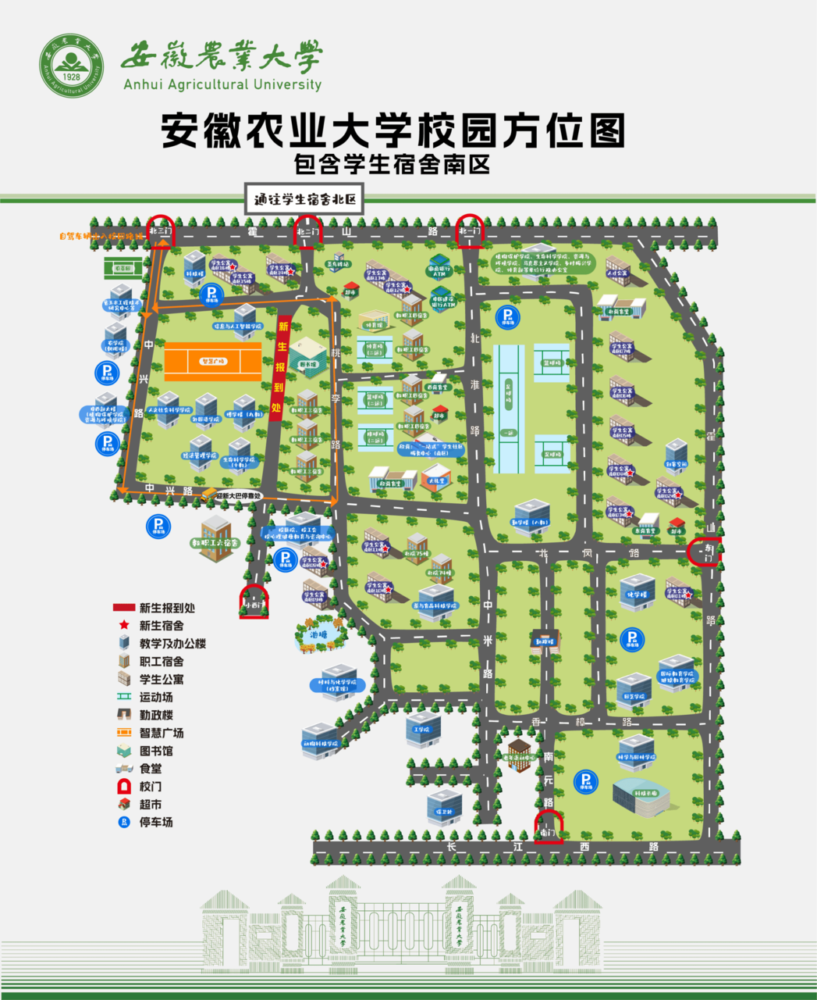
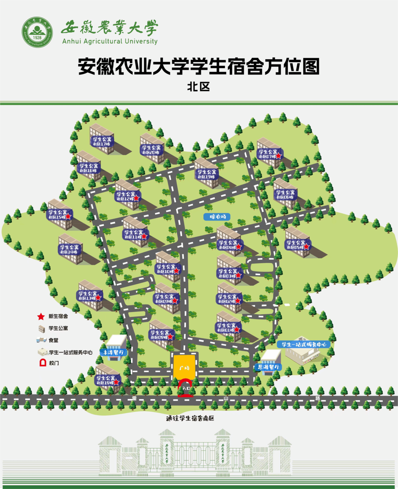

# 寝室情况简介

> **所属模块**：新生专栏

寝室分为宿舍南区和宿舍北区

一.宿舍南区(校内寝室楼X1-16)

(1)X1-X7
①分布在东门附近，距离八教勤学楼和一运比较近，因此大一上课比较方便。
②生活:
ⅰ)距离东苑、北苑食堂较近，推荐东苑瓦香鸡和干锅鸡很好吃，北苑有少数民族窗口
    晚上东门外霍山路小吃街，推荐瘦肉丸炸串      东门可以放外卖，是点外卖的不二宿舍。
    东门还有红府超市，零食饮料不用愁。
ⅱ)出东门往北走(北一门方向)，在三岔路口往西拐(安庆路方向)，可以找到干休二所公交站，乘坐114路可前往合肥火车站(底站)。
       出门往南走(环球时代广场方向)，在环球广场有安农大地铁站d口，可乘坐2号线，大东门换乘1号线或三孝口换乘5号线，均可到达合肥南站。⭐⭐但如果想去合肥站(火车站)，只能换乘1号线。

(2)X8-X11
①分布在学校南边，距离博学楼图书馆比较近
②生活:
ⅰ)距离欣苑和西苑比较近，推荐西苑的瓦香鸡、亦鱼亦饭还有麻辣烫。
     在西苑旁边的农大后勤超市可以买零食饮料
     晚上还可以去小西门官亭路美食街大吃特吃
ⅱ)从小西门出去可以前往之心城和国购大厦，逛街购物真的奈斯

(3)X12-X16
①分布在学校的北边，分布在北二门的两侧，距离图书馆，博学楼，智慧广场比较近，晚上可以跑跑步、散散心。
②生活:
ⅰ)可以选择到校外食堂去吃，北三门当然也有不错的快餐(重庆小面、鸡公煲、盖浇饭)。
        北二门校园内外都有便利超市，非常方便
        晚上过天桥有银河护胃队……北二门安农大小吃街，五六十种小吃，吃货们有口福了。
         X12-14点外卖可以填北二门架子，X15-16 外卖可以填北三门架子
 ⅱ)北二门出去就是奥林花园站，乘坐114可直达火车站。如果要去合肥南站，省钱的话可以从安农大地铁口乘地铁，不然的话就打的。

二.宿舍北区(合肥大学生公寓/校外公寓G1-20)

①有丰泽，思源两大食堂
推荐思源一楼的炸串拌饭，丰泽二楼的麻辣香锅和土豆泥拌饭也很不错。

附1寝室情况
<a href="./宿舍情况及图片.pdf" download>宿舍情况及图片（PDF）</a>
[浴室及卫生间](/04-生活专栏/06-浴室及卫生间/)

附2相关问题
[寝室相关问题](/04-生活专栏/04-寝室相关问题/)
