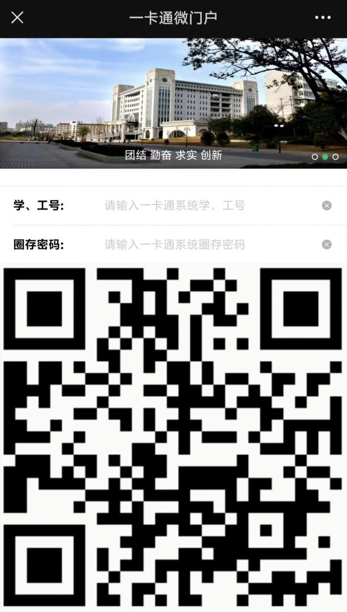

# 本科新生学杂费标准及缴费方式

> **所属模块**：新生专栏

学杂费标准详见新生手册

附:
1.校园一卡通说明
[校园一卡通](/04-生活专栏/15-校园一卡通/)

2.一卡通学生缴费指南
(学杂费，考试、比赛报名费，均可在此缴费)
[一卡通缴费操作](https://ykt.ahau.edu.cn/0303.html)

3.校园一卡通微门户
(初始密码为身份证号后六位，遇X用0代替)
①微信/支付宝/银联云闪付  扫码可直接缴费

②快捷链接直达智慧安农
[安农缴费微门户](https://ykt.ahau.edu.cn/zsan/web)
