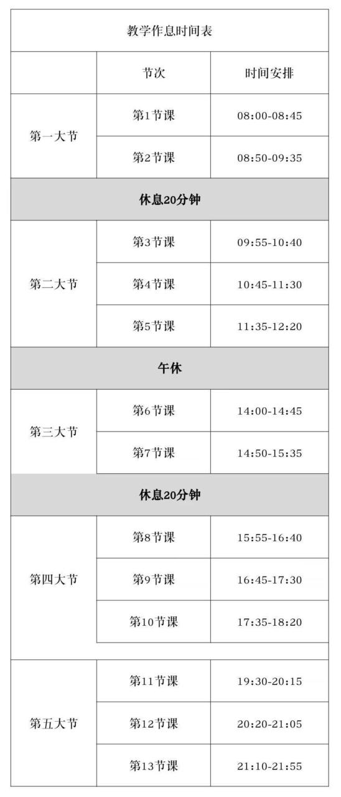

# 课程表详细导入方法

> **所属模块**：学业专栏

### 课程表详细导入方法

1.课程表

学校排好的课程表在正方教务(本科教务)，但是查看起来极不方便，导入至课程表软件可以方便查看，极力推荐你们使用wake up课程表(超级课程表不好用)

课程表导入方法如下，(注意:进入智慧安农前一定要打开掌上安农软件，挂上VPN，不然进入不了本科教务)

附:教学作息时间表和教学日历

## 相关文件

> 以下文件挂在学习通上，需登录后到专题页下载，后续会逐步镜像进本仓库。

- [Wake up课程表导入课程表的方法.pdf](https://mooc1.chaoxing.com/mooc-ans/ztnodedetailcontroller/visitnodedetail?courseId=253549820&knowledgeId=998070442)（934.76 KB）
- [Wake up课程表详细导入方法.mp4](https://mooc1.chaoxing.com/mooc-ans/ztnodedetailcontroller/visitnodedetail?courseId=253549820&knowledgeId=998070442)（14.4 MB）
- [未命名附件](https://mooc1.chaoxing.com/mooc-ans/ztnodedetailcontroller/visitnodedetail?courseId=253549820&knowledgeId=998070442)

::: tip 原始出处
本节整理自学习通专题「安农新生攻略」节点 [课程表详细导入方法](https://mooc1.chaoxing.com/mooc-ans/ztnodedetailcontroller/visitnodedetail?courseId=253549820&knowledgeId=998070442)（Ⅱ.0.学业相关问题）。
:::
