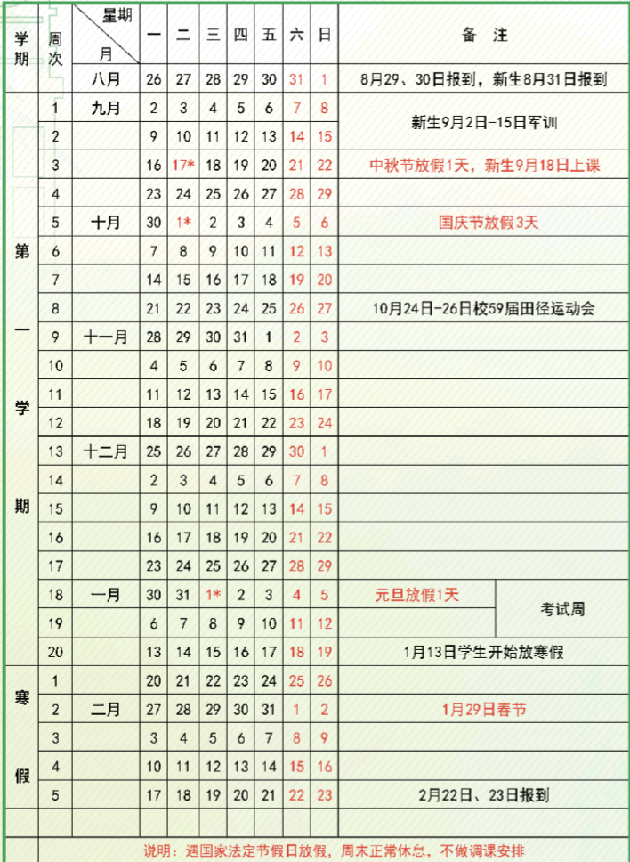
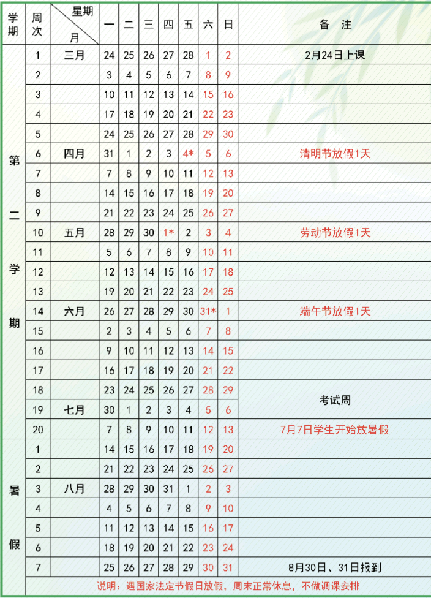
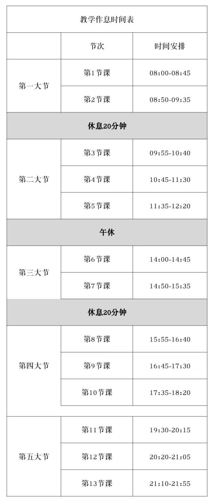

# 教学日历、时间表及日常作息

> **所属模块**：学业专栏

### 教学日历、时间表及日常作息

一.2024-2025年教学日历

二.时间表

三.日常作息

(一).上课时间

1.有课要按照课程表对应的时间按时上课。

2.大一需要上晚自习的，安排在周一至周四的晚上第11、12节。会有老师和学生会检查，有事需向导员请假。

(如果课表安排了晚上的课，则依据课时安排教学时间，比如普通两课时的课上到第12小节，而实验课会上到第13小节。)

3.对于第二、四大节的说明，一般会安排三课时的课程，如大学英语、实验课等，如果安排了两课时的课程只需要上到11:30。

(二).空闲时间

没课的时候,可以自行安排。

## 相关文件

> 以下文件挂在学习通上，需登录后到专题页下载，后续会逐步镜像进本仓库。

- [未命名附件](https://mooc1.chaoxing.com/mooc-ans/ztnodedetailcontroller/visitnodedetail?courseId=253549820&knowledgeId=998070444)

::: tip 原始出处
本节整理自学习通专题「安农新生攻略」节点 [教学日历、时间表及日常作息](https://mooc1.chaoxing.com/mooc-ans/ztnodedetailcontroller/visitnodedetail?courseId=253549820&knowledgeId=998070444)（Ⅱ.0.学业相关问题）。
:::
