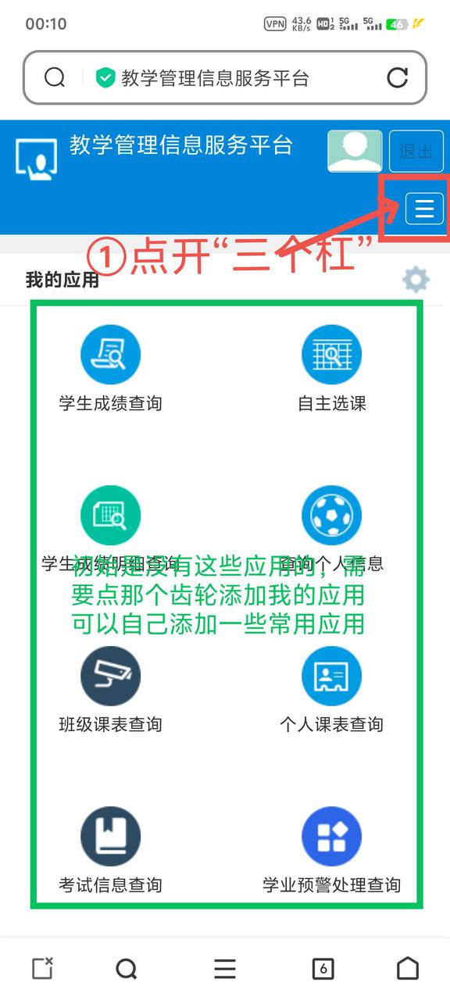
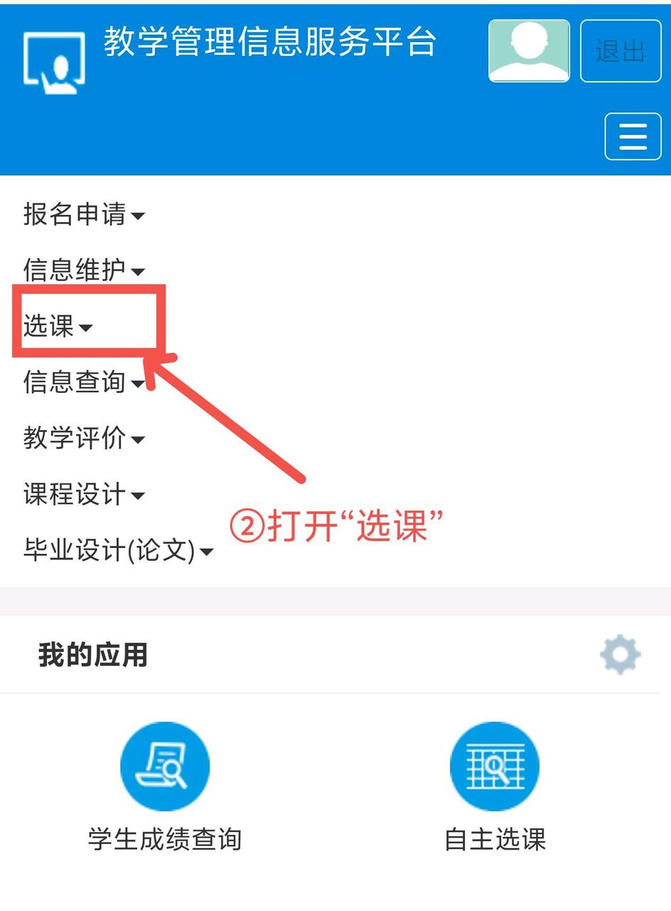
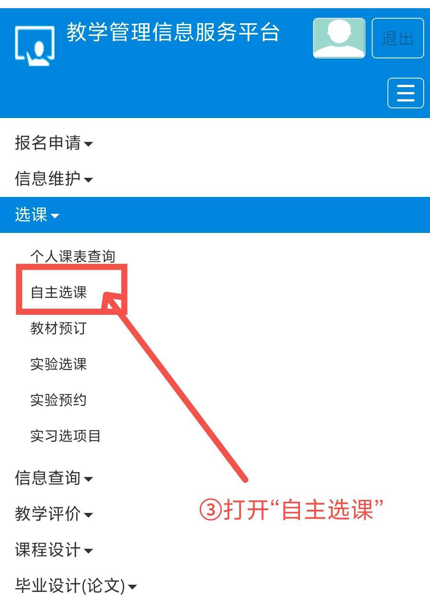
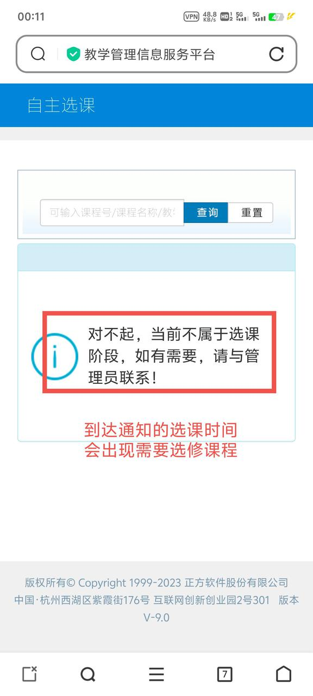

# 抢选课（体育、选修、退改）

> **所属模块**：学业专栏

### 抢选课（体育、选修、退改）

抢课备用网址一

抢课备用网址二

①打开智慧安农-本科教务

②点击“选课”

③点击“自主选课”

④恭喜你可以选课了

## 相关文件

> 以下文件挂在学习通上，需登录后到专题页下载，后续会逐步镜像进本仓库。

- [未命名附件](https://mooc1.chaoxing.com/mooc-ans/ztnodedetailcontroller/visitnodedetail?courseId=253549820&knowledgeId=998070445)
- [未命名附件](https://mooc1.chaoxing.com/mooc-ans/ztnodedetailcontroller/visitnodedetail?courseId=253549820&knowledgeId=998070445)

::: tip 原始出处
本节整理自学习通专题「安农新生攻略」节点 [抢选课（体育、选修、退改）](https://mooc1.chaoxing.com/mooc-ans/ztnodedetailcontroller/visitnodedetail?courseId=253549820&knowledgeId=998070445)（Ⅱ.0.学业相关问题）。
:::
