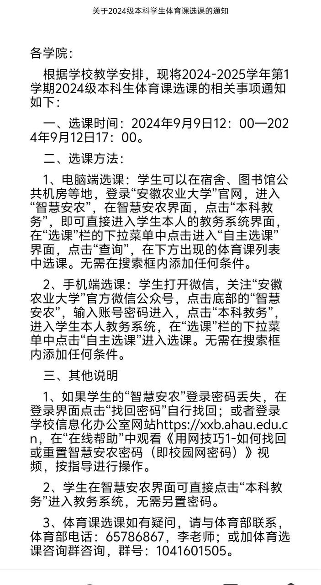
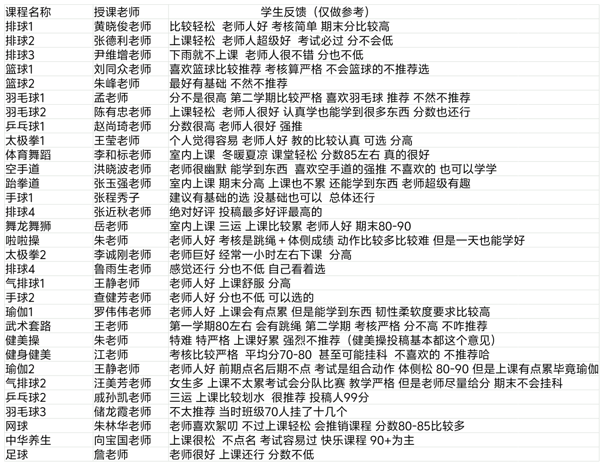

# 体育课、体测及步道乐跑（校园跑）

> **所属模块**：学业专栏

### 体育课、体测及步道乐跑

大一新生，教务处会排好基础课程(比如高等数学，大学英语，无机化学等)，我们是需要选择体育课和选修课的，中华养生和太极拳是公认最好的体育课，选修课依据自己兴趣自行选择

一.体育课

1.抢体育课

登录智慧安农-本科教务-选课-自主选课

2.体育课推荐(学长学姐反馈，仅供参考)

3.成绩构成

eg:俱乐部体育我选择太极拳，太极拳最后有90分，体测有80分，乐跑跑了20次

体育最终成绩为:

80*50%+90*45%+20/40*5=83分

二.体质测试

1.时间统一安排在秋学季某个月，具体时间以实际为准，统一测试结束后可以跟老师申请全项或部分项目重测。

2.体质测试评分

①小程序输入数据自动打分

②《国家学生体质健康标准》体测评分量表

三.步道乐跑(校园跑)

步道乐跑模块计入体育课成绩，占总成绩5%。

跑满一定的次数，可以得到这一模块的5分。

比如大一需要跑满40次，如果跑了一次就是1/40*5=0.125分，多少次有多少类推。

1.需要下载步道乐跑APP.

2.跑之前一定要填写个人信息，完成身份认证。

3.要完成人脸注册，才会被系统抓拍到

4.接下来你就可以开始跑了

5.乐跑地点

①第一运动场(足球场)

②智慧广场(图书馆对面)

③校外公寓(彩色跑道)

## 相关文件

> 以下文件挂在学习通上，需登录后到专题页下载，后续会逐步镜像进本仓库。

- [未命名附件](https://mooc1.chaoxing.com/mooc-ans/ztnodedetailcontroller/visitnodedetail?courseId=253549820&knowledgeId=998070446)
- [未命名附件](https://mooc1.chaoxing.com/mooc-ans/ztnodedetailcontroller/visitnodedetail?courseId=253549820&knowledgeId=998070446)

::: tip 原始出处
本节整理自学习通专题「安农新生攻略」节点 [体育课、体测及步道乐跑](https://mooc1.chaoxing.com/mooc-ans/ztnodedetailcontroller/visitnodedetail?courseId=253549820&knowledgeId=998070446)（Ⅱ.0.学业相关问题）。
:::
