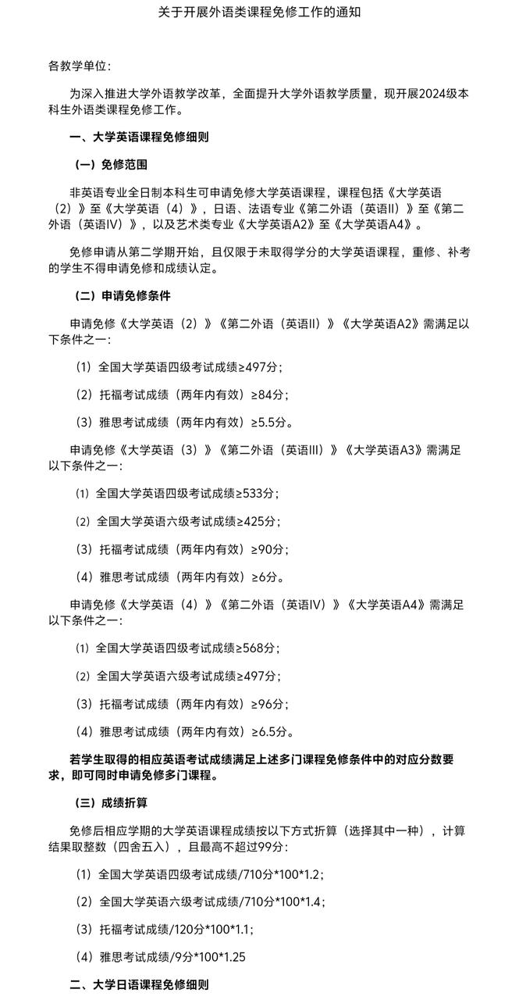
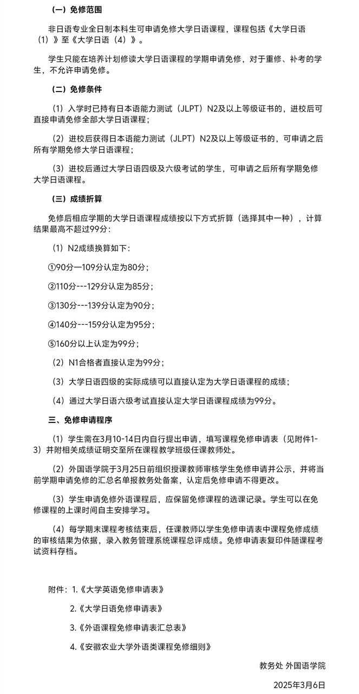

# 外语类课程免修

> **所属模块**：学业专栏

### 外语类课程免修

一.相关通知

二.附件

## 相关文件

> 以下文件挂在学习通上，需登录后到专题页下载，后续会逐步镜像进本仓库。

- [附件1.大学英语免修申请表.docx](https://mooc1.chaoxing.com/mooc-ans/ztnodedetailcontroller/visitnodedetail?courseId=253549820&knowledgeId=998070447)（114.78 KB）
- [附件2.大学日语免修申请表.docx](https://mooc1.chaoxing.com/mooc-ans/ztnodedetailcontroller/visitnodedetail?courseId=253549820&knowledgeId=998070447)（107.65 KB）
- [附件3.外语课程免修申请表汇总表.xlsx](https://mooc1.chaoxing.com/mooc-ans/ztnodedetailcontroller/visitnodedetail?courseId=253549820&knowledgeId=998070447)（10.98 KB）
- [附件4.《安徽农业大学外语类课程免修细则》.pdf](https://mooc1.chaoxing.com/mooc-ans/ztnodedetailcontroller/visitnodedetail?courseId=253549820&knowledgeId=998070447)（81.75 KB）

::: tip 原始出处
本节整理自学习通专题「安农新生攻略」节点 [外语类课程免修](https://mooc1.chaoxing.com/mooc-ans/ztnodedetailcontroller/visitnodedetail?courseId=253549820&knowledgeId=998070447)（Ⅱ.0.学业相关问题）。
:::
