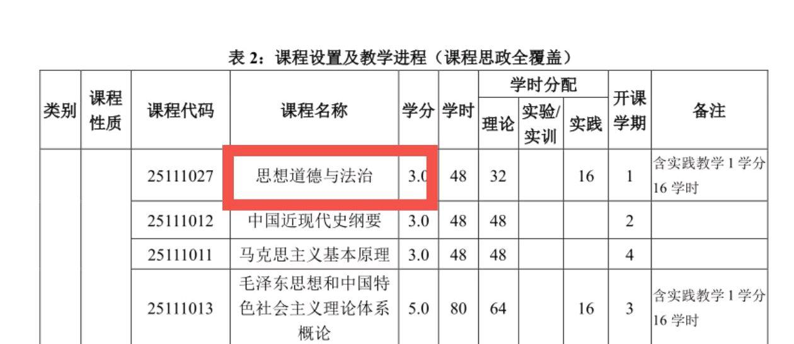

# 学分、绩点、学分绩点以及平均绩点

> **所属模块**：学业专栏

### 学分、绩点、学分绩点以及平均绩点

一.学分，是这门课可以给你提供的计算进毕业要求中的分数。我们学校的学分可大体上分为“必修课学分、选修课学分、素质拓展学分”这三类。

⭐学生手册第十六条 考核分为考试与考查两种。考核成绩评定按学校相关文件执行。考试成绩达到或超过60分者，即获得该门课程的学分。考查成绩及格及其以上者，即获得规定的相应学分。

⭐1.必修课学分 又分为公共必修课和专业必修课，就是本专业每个学生都要学习的课程，该部分学分不能被其他学分替代，如果没有获得就不能毕业。大一大二上的课很多都是公共必修课，比如大学体育、大学语文、大学英语、高等数学、思想政治、马克思、毛概、近代史等等。大三大四基本上都是专业必修课和专业选修课。(本科人才培养方案里有每一科学分)

如表2:比如你学的这门“思想道德与法治”是3个学分，那么期末考试时你只要考及格了(达到60分)，你就能获得这3个学分。

⭐2.选修课学分 又分为公共选修课和专业选修课，就是有很多门课程供你选择，只要你选修课的学分达到要求就能毕业，如果挂科了，再选其他课程，考试通过补上学分就行。(很少听说谁的选修课挂科，选修课老师一般比较仁慈)

⭐3.素质拓展学分 也叫做第二课堂学分，每个学生必须修满4个学分才能毕业。

安徽农业大学大学生素质拓展学分是学生参与教学计划设定课程以外的“第二课堂”内容，按规定的程序申请并通过学校审核后，由学校认可并记载在学生档案中的学分(必修学分)。学生在校学习期间必须获取实践教学平台中的4个素质拓展学分，方准许毕业。分为文化分、实践分和科研分三种，分别要修满1分、1分、2分才能毕业。大家可以提前下载“PU口袋校园”APP绑定安农大的校园活动看到往期的活动，通过参加丰富多彩的活动来获得这些学分。

二.大学里的绩点就类似于中小学的分数，大学里是通过绩点来比较成绩的好与差，绩点与奖学金和保研直接挂钩。

(一)⭐学生手册第二十四条 成绩与绩点

1.成绩与绩点的关系：百分制成绩X≥60分，课程学分绩点=1.0+0.1*(X-60)；百分制成绩X<60分，课程学分绩点=1。(0≤X≤100)

2.学分绩点、平均学分绩点的计算：

①.将某一课程的学分乘以该课程所得的绩点，即为该课程的学分绩点；

②.以学生全部课程所得的学分绩点之和，除以该生同期修读的学分数，即可得该生平均学分绩点。平均学分绩点=(各课程绩点×各课程对应学分)÷总课程学分。。

⭐例如：

某学生选修五门课程，

学分分别为 :       6、5、4、3、5，

其成绩分别为：90、80、70、60、50，

则其绩点应分别为：4.0、3.0、2.0、1.0、0，

其学分绩点分别为：24、15、8、3、0，

则该生平均学分绩点=(24+15+8+3+0)/(6+5+4+3+5)=2.17。

3.考核(五级制)成绩与绩点的关系

成绩及其绩点数

优 4.0

良 3.0

中 2.0

合格 1.0

不及格 0

学生考核成绩应真实，符合学校有关规定。

(二)⭐学生手册第二十五条 平均学分绩点是衡量该学生学习质量和数量的重要标准。平均学分绩点按学年计算；从入学后实行分学年计算平均学分绩点和累计平均学分绩点；学生毕业时计算毕业平均学分绩点。

## 相关文件

> 以下文件挂在学习通上，需登录后到专题页下载，后续会逐步镜像进本仓库。

- [未命名附件](https://mooc1.chaoxing.com/mooc-ans/ztnodedetailcontroller/visitnodedetail?courseId=253549820&knowledgeId=998070452)
- [未命名附件](https://mooc1.chaoxing.com/mooc-ans/ztnodedetailcontroller/visitnodedetail?courseId=253549820&knowledgeId=998070452)

::: tip 原始出处
本节整理自学习通专题「安农新生攻略」节点 [学分、绩点、学分绩点以及平均绩点](https://mooc1.chaoxing.com/mooc-ans/ztnodedetailcontroller/visitnodedetail?courseId=253549820&knowledgeId=998070452)（Ⅱ.0.学业相关问题）。
:::
