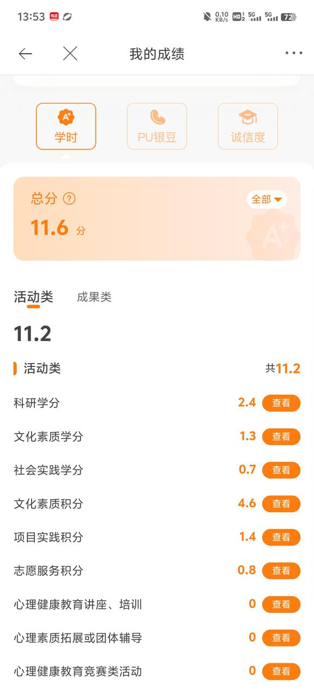
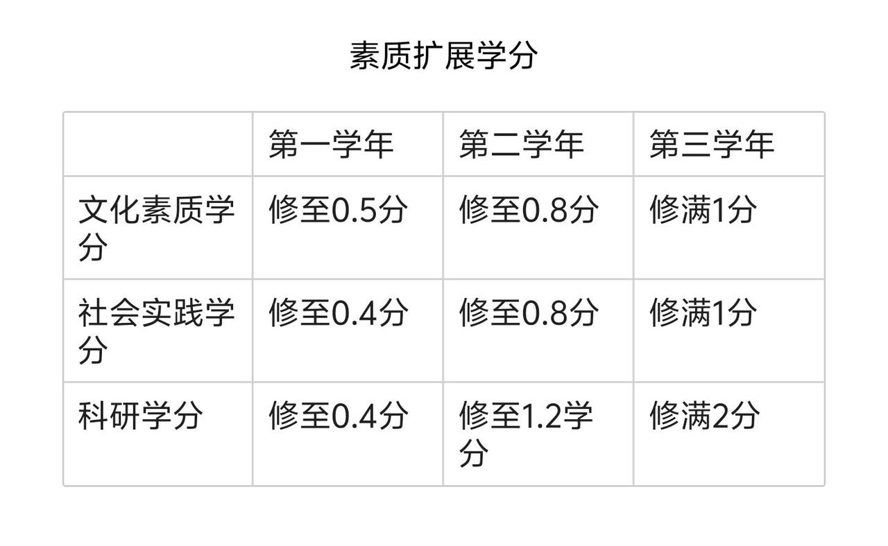
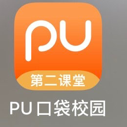
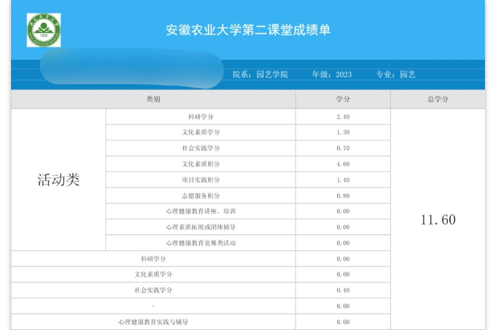
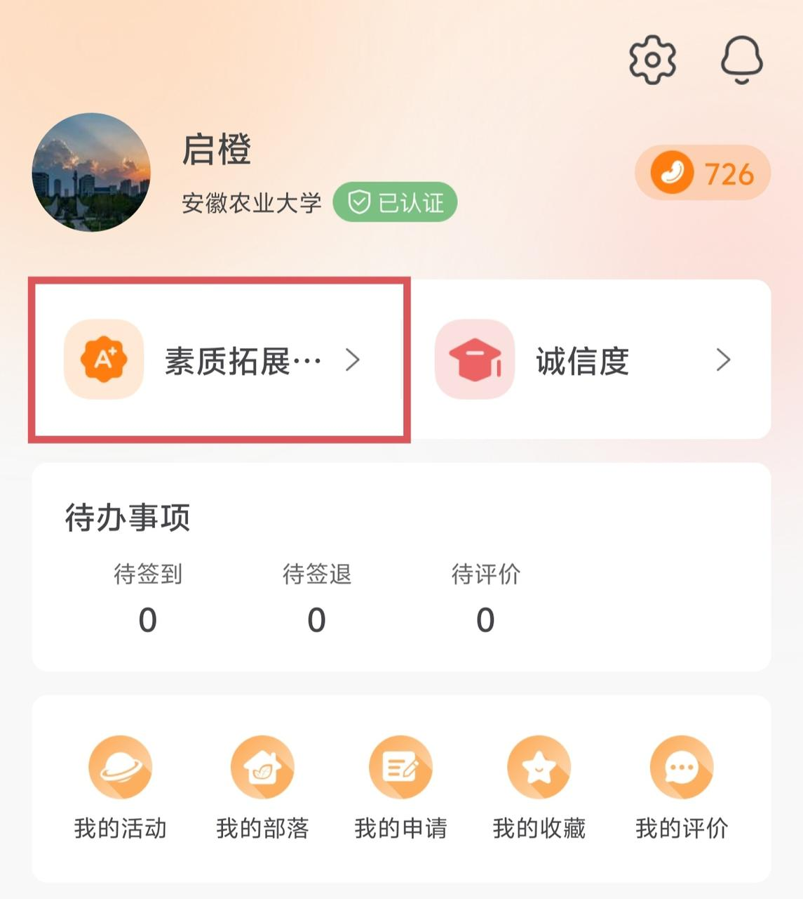

# PU 及第二课堂活动（素质拓展学分、素拓）

> **所属模块**：学业专栏

### PU 及第二课堂活动

一.第二课堂介绍

“第二课堂成绩单制度”旨在利用信息化手段将学生在校期间参与的课，除课业成绩以外的经历奖励和荣誉记录下来，为学生们打造一份在学校期间除课业成绩以外的专属第二课堂成绩单，多方位多角度的反映学生在校期间的发展情况。

第二课堂成绩有关乎着同学们能否顺利毕业，它需要大家在第二课堂拿到相应学分。

二.第二课堂学分

学分分为活动类学分和申请类学分。

活动类学分：学校发起的赋予了学分的活动，学生参与此类活动并正常签到（退），活动发起人在活动结束后申请完结，由终审老师负责审核申请进行完结活动并发放学分学分与发放次日凌晨生效。

申请类学分：只有开通第2课堂成绩单的学校学生才可申请此类学分。学生在PC端申请学分页面。根据自身符合的类别填写信息并上传证明材料进行申请。学生提交学分认定申请之后由学校老师进行审核，是否发放学分。

三.二课需要修的四类素拓学分(积分)

1.文化素质学分(大学需修1分)

主要形式：人文书籍阅读与创作，校园文化活动，艺术展演等。

2.社会实践学分(大学需修1分)

主要形式：寝室教室文明创建、劳动实践等。

3.科研学分(2分)

主要形式：学科竞赛，创新创业、学术讲座、技能提升、职业生涯规划等。

4.积分(国助生需要修的，包含文化、素质、项目积分，总和达到每一档要求即可。)

劳动教育、志愿活动

国家助学金资助家庭经济困难的全日制本科生，平均资助标准为每生每年3300元。

我校实行分档资助，分档标准为

丙等2000元(3积分每年)，

乙等3000元(6积分每年)，

甲等4500元(9积分每年)。

如果没修满第二年可能会不允许申请。

全日制在校退役士兵学生全部享受国家助学金，资助标准为每生每年3300元。

四.pu 口袋校园

1.软件下载方式

应用商店搜索pu口袋校园

2.登陆进入方式

待通知账号激活后，选择对应学校，输入学号和密码进行登录或用手机号登录。

3.作用

“Pu口袋校园”作为一个维护我校第二课堂成绩单制度实施的软件，同学们在“Pu口袋校园”可以看到全校的第二课堂活动也能自主报名参加活动，及时看到自己二课得分及明细。

4.使用方法

点击首页全校活动，根据自身情况选择合适活动，点击报名后通过审核即可参与，需注意是否需要签到签退。按要求完成在活动报名成功后，有事不能参加活动应提前在系统取消报名，若活动已经开始，则需要在活动QQ群向活动负责人报备，若无故没有按时签到或签退则会降低诚信度。

大多活动的报名后通过线上加入QQ群，在群文件找到活动策划书了解详情活动内容，且后续活动内容的跟进也需时刻关注群。

在“我的”板块，可以看到你的诚信度，各学分以及成绩单预览。

在“校园生活”板块，你可以看到同学们身边的校园新闻、生活学习的分享，也可以与他们互动。

::: tip 原始出处
本节整理自学习通专题「安农新生攻略」节点 [PU 及第二课堂活动](https://mooc1.chaoxing.com/mooc-ans/ztnodedetailcontroller/visitnodedetail?courseId=253549820&knowledgeId=998070453)（Ⅱ.0.学业相关问题）。
:::
