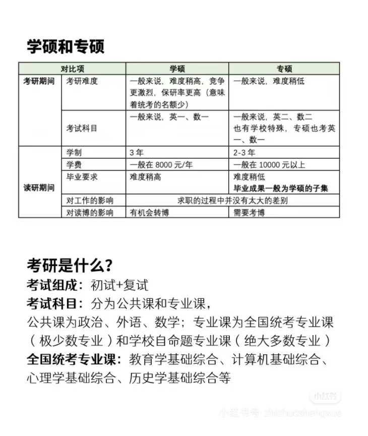
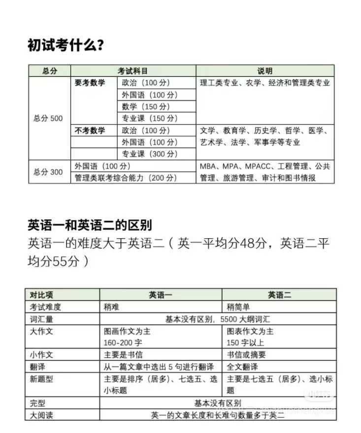
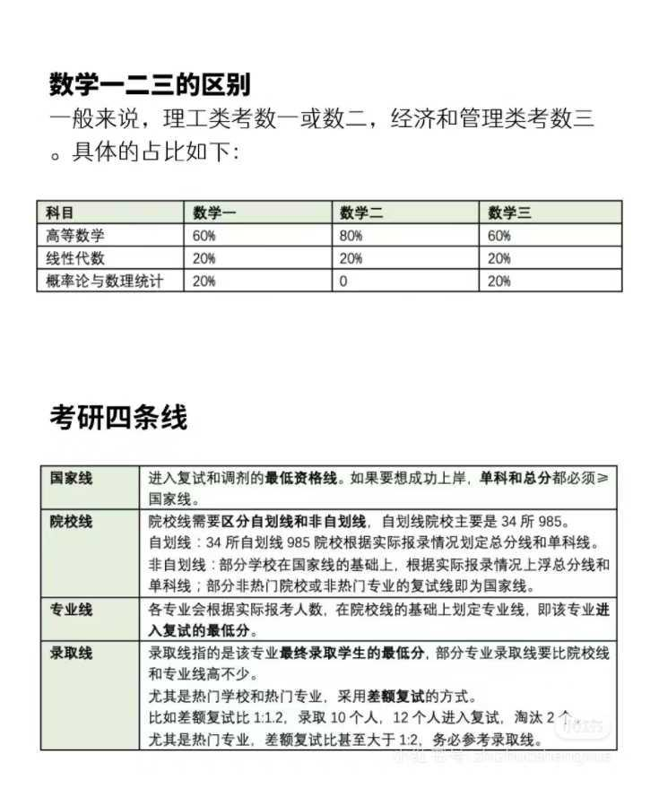

# 考研

> **所属模块**：学业专栏

### 考研

⭐最近几年考研人数飙升！！！

2024考研报名人数为438万，

2023考研报名人数为474万，

2022考研报名人数为457万，

2021考研报名人数为377万，

2020考研报名人数为341万

我们学校的学生考研基本上保底本校(过线就能上），部分涉农专业升学率达到70%。

大部分考研人都是考研到了211，也有不少去985的。（官方公布考研上岸双一流院校的比例为50%）

相比高考，我们安农大同学上名校研究生的概率大大提高，其中不乏中国农业大学（985）、浙江大学、上海交通大学、复旦大学、北京大学、清华大学、中国科学技术大学等世界名校。

相信大家在本科期间一定也会思索考研相关事宜。以下给大一的你一些考研的相关建议供你参考:

大一大二可以为考研提前做什么？

⭐大一：

如果保研无望

前提：明确考研目标

1.尽早把四六级过了，有可能成为加分项

2.想清楚靠什么专业?要不要跨考?

3.高数课认真对待，尽量学会每一个知识点

4.专业课认真听讲，多去图书馆借一些专业相关的书翻翻，专业课期未争取考高分

5.过计算机二级

⭐大二：

1.学习考研英语单词，尤其未来考英语一的同学们

2.英语基础差的同学，在本科期间就搭配(田静)的语法视频

3.教资+其他想考的证书(驾照等等)

⭐大三：

1.搜集考研信息，了解考研常识

2.确定考研专业院校档次(确定不了学校后期再说，先学习公共课)

3.制定全年大概得学习计划，最迟大三下开始正式进行备考

4.准备考研用书

专业课参考书：目标院校官网会公布，不同学校的不一样(统考专业外)，如果官网没有就去联系已上岸的学长和学姐。

公共课参考书：

①英语用书:

《红宝书》：单词

《句句真研》长难句：田静

《黄皮书》真题：张剑

《英语高分写作》作文：王江涛

②政治用书：

肖秀荣《精讲精练》《1000题》《八套卷》《四套卷》

③数学用书：

《高等数学基础篇》《高等数学辅导讲义》

《复习全书》《线性代数辅导讲义》

《概率论与数理统计》《660》《李林880》

《数学历年真题》《李林四六套卷》

⭐大四全年学习计划

3月-6月：基础复习阶段重点复习英语和数学，打基础阶段，结合考研视频全程过知识点；

7月-8月：提高阶段主要看强化视频、重点突破数学、英语阅读、专业课基础等，这个暑假建议留校复习；

专业课开始复习，多看经验贴，准备把握专业课复习过程；

英语重点在阅读部分，词汇、长难句保持；

数学把所有基础内容全部复习完毕，基本完成第一遍刷题；

继续调整心态，保持健康、积极的复习态度；

8-9月：出考纲阶段关注招生简章、考研大纲，看考研大纲变化；

9-10月：报名和差缺补漏、真题考研报名和查缺补漏、做真题阶段

11月-12月：

11月模拟阶段做真题模拟题，现场确认；

12月临考阶段打印准考证、订考研房间；

次年1月-2月：复试备考阶段根据复试大纲，准备复试

次年3月-4月：复试出考研成绩，进行复试；

次年3月-5月：调剂阶段；

次年6月-9月：录取、报到阶段：

::: tip 原始出处
本节整理自学习通专题「安农新生攻略」节点 [考研](https://mooc1.chaoxing.com/mooc-ans/ztnodedetailcontroller/visitnodedetail?courseId=253549820&knowledgeId=998070459)（Ⅱ.0.学业相关问题）。
:::
