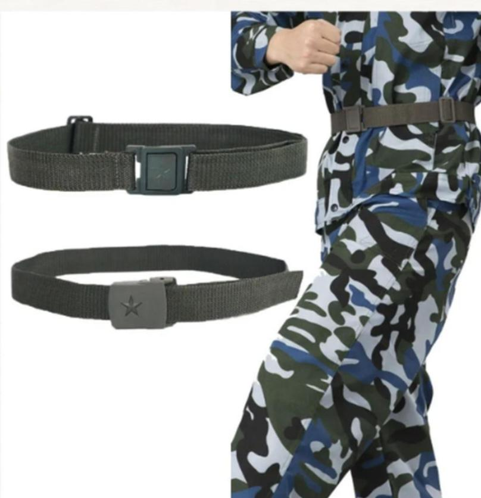
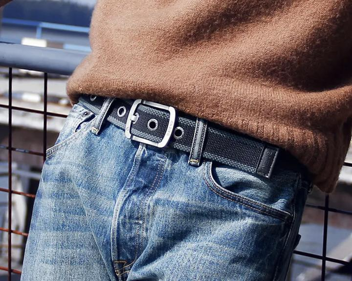

# 新生军训

> **所属模块**：生活专栏

### 新生军训

1.军训时间：2024年的军训时间是9月2日—15日

2.军训地点：第一运动场，第二运动场，以及周围能站人的空地

3.军训内容：军姿、踢正步、队列行进、汇报表演的排练，军训强度不大，一般没有晚训，熬一熬也就过去啦。

4.可能会需要的物品

-学校会发帽子、短袖、外套、裤子、鞋子、腰带(这是编制腰带，不是裤腰带<皮带>，编制腰带是绑在外套外面的，裤腰带是束裤子的)

如图这是编制腰带，系在外面的

如图这是裤腰带(皮带)

- 鞋垫：一定一定要买个鞋垫，那个解放胶太硬了。买好一点的，最好是乳胶、爆米花材质的，至少站军姿时候好受一点。

- 皮带：这个是不会发的，发的是腰带，可别弄错了。裤子完全是直筒型，没有裤胺带，裤子会掉下来，(不想买用条绳子捆着也凑合)

- 防晒产品：防晒霜涂完还可以带着，休息时补涂；女生可以准备冰袖，有的教官给戴

- 雨伞或遮阳伞：军训后期有的可以打伞

- 大容量水杯：一般会提供桶装饮用水

- 防蚊水：蚊子会很多

- 芦荟胶：晒伤补水必备产品

5.一些注意事项

床帘等军训结束再买，军训时不允许挂床帘

可以准备透气防晒的小包，保护手机不被晒炸（或许可以试试把奶茶外卖翻个面)

::: tip 原始出处
本节整理自学习通专题「安农新生攻略」节点 [新生军训](https://mooc1.chaoxing.com/mooc-ans/ztnodedetailcontroller/visitnodedetail?courseId=253549820&knowledgeId=998070421)（Ⅰ.2.大学生活专栏）。
:::
