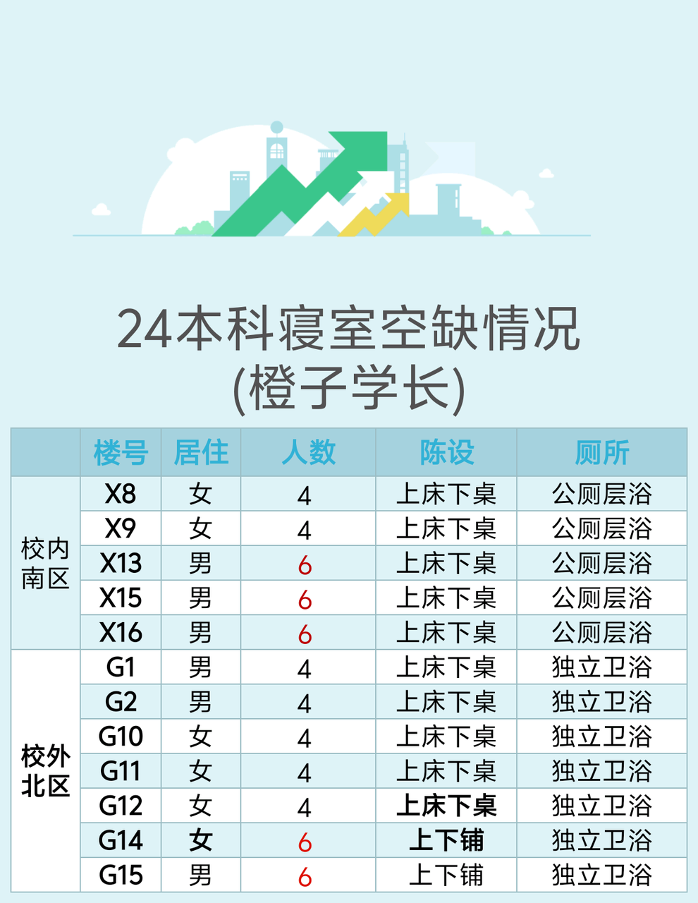
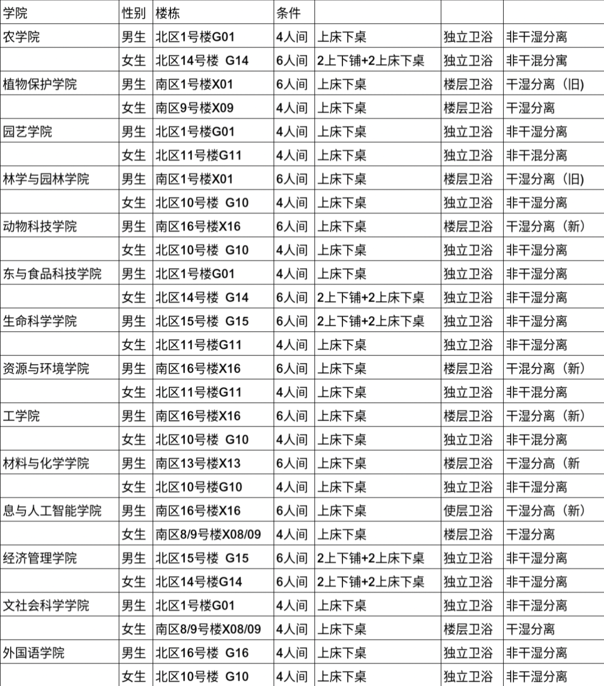
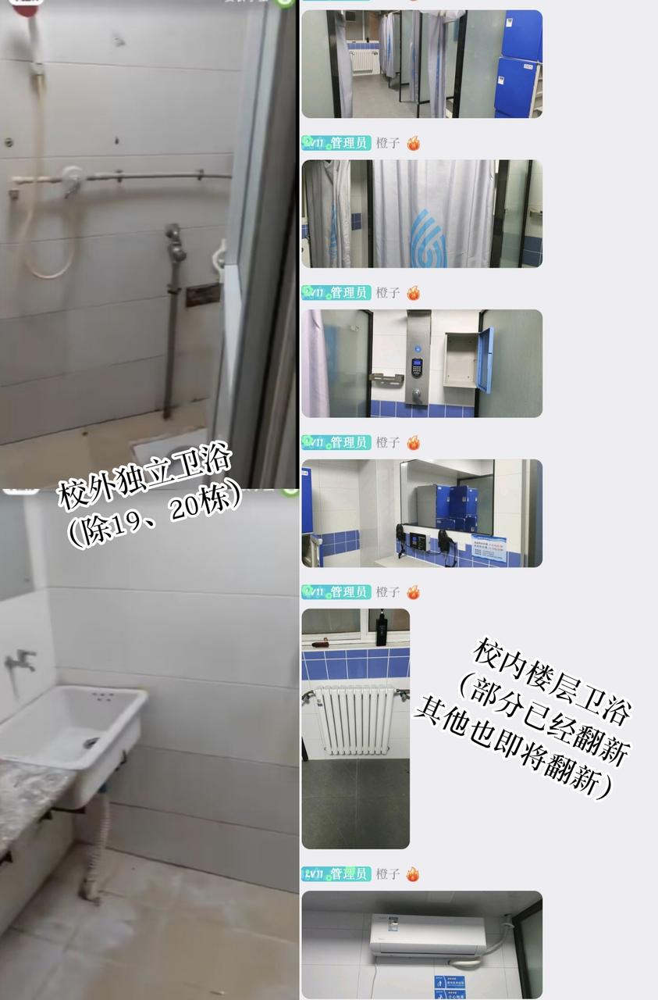
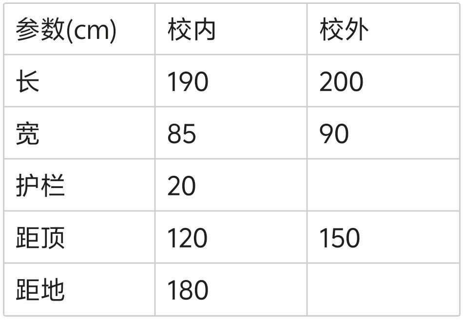
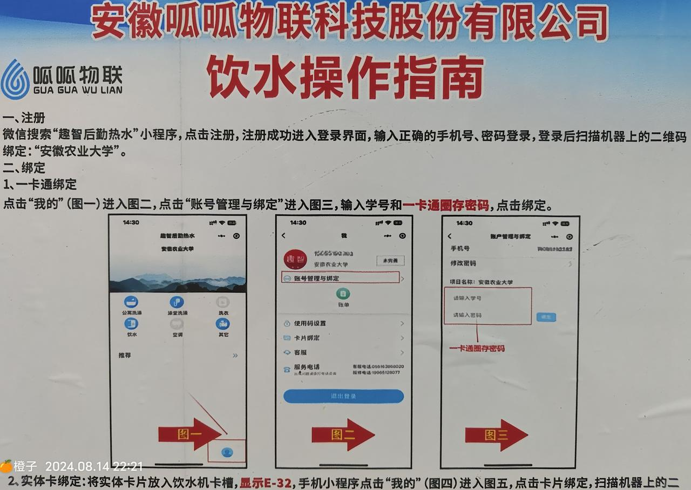
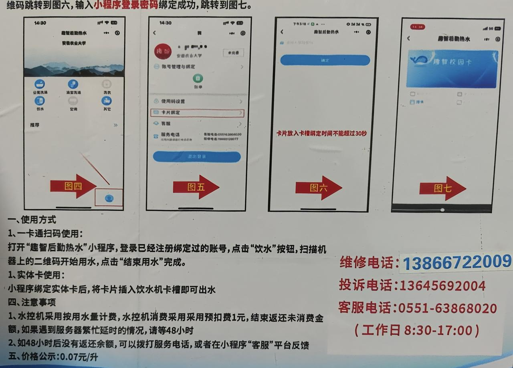
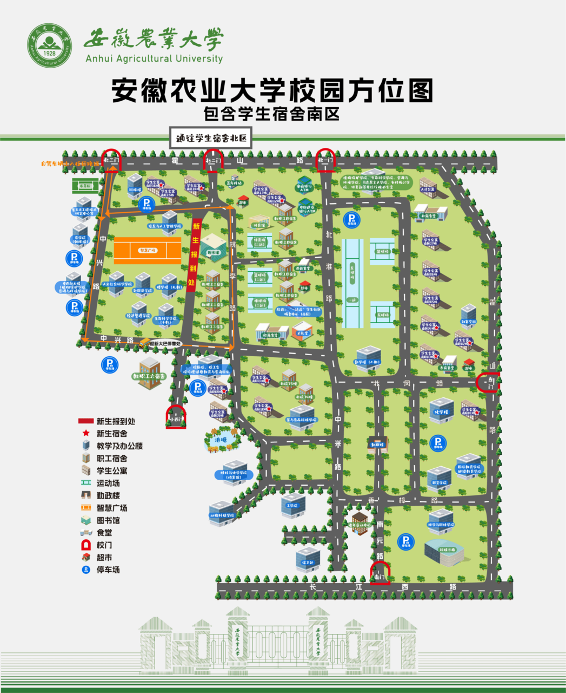
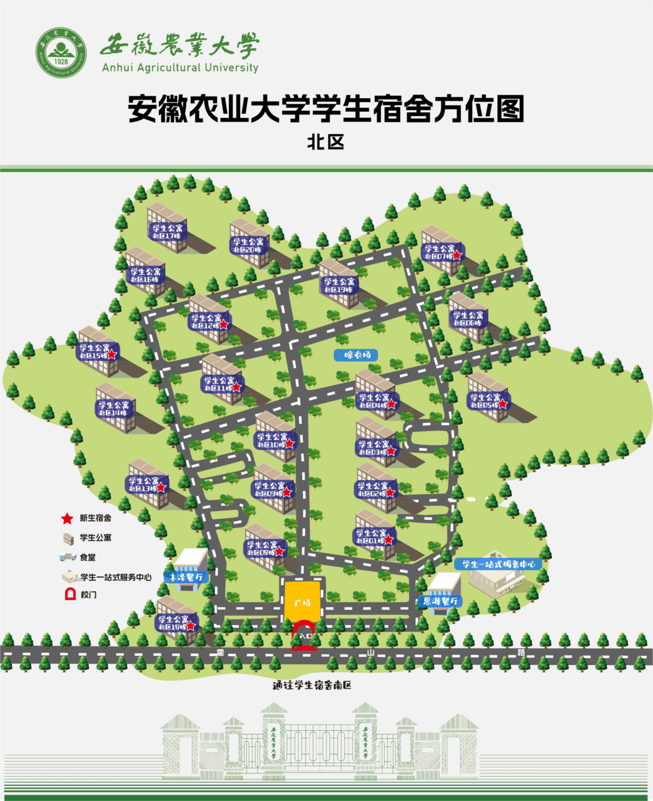

# 寝室相关问题

> **所属模块**：生活专栏

### 寝室相关问题

24级本科寝室空缺情况

24级本科寝室实际情况

独立卫浴(非干湿分离)和校内独层比较

1.寝室楼与大致楼层由学校统一分配，主要看毕业生空出来的寝室有哪些新生就会分到哪些寝室楼。

2.床的大小是 1.9x0.9m，一部分公寓的床的大小是2*0.9m，不从家里带的，可以提前买好床上用品（学校的质量不是很好）

3.宿舍是有不准带违禁品，如烹煮器具、直发棒卷发棒等任何以发热为用途的物品，会导致跳闸等问题。

4.一般都是同专业同班，在一个寝室，少部分同学会被分入混寝。

5.大多是4人寝，上床下桌，也有少部分是6人寝。

校内六人间(上床下桌)

校外三人间

校内四人间(上床下桌)

校外六人间

6.校外公寓G1-20都是独立卫浴(其中X18-20是干湿分离)

校内X1-16均为公共厕所，校内宿舍X3-7 是公共浴室(这几栋一层有栋浴，不够可能要去游泳馆)，校内其他是独层浴室。

7.宿舍楼道都配备热水器，可以凭一卡通扫码灌热水。

8.一般一层宿舍有两个洗衣机还有吹风机，一般一次不超过1块钱。

①校外公寓需要用“智慧笑联”app。

②校内可直接吹风机刷卡，洗衣机则用"U净"app。

9.大部分宿舍可以被校园WiFi覆盖，每月5元网费，无校园WiFi覆盖的宿舍WiFi可以找营业厅进行办理。

10.空调费用需要在一卡通内进行充值，以及澡堂水费。

11.登录智慧安农抢宿舍时，可以看到宿舍的大致床位分布。

注意:1、2号床是靠阳台的，34(56)是靠门的。

无论宿舍南区还是宿舍北区，单号是向阳的，如227向阳，228背阳。

## 相关文件

> 以下文件挂在学习通上，需登录后到专题页下载，后续会逐步镜像进本仓库。

- [校内六人间(上床下桌).mp4](https://mooc1.chaoxing.com/mooc-ans/ztnodedetailcontroller/visitnodedetail?courseId=253549820&knowledgeId=998070410)（6.96 MB）
- [校外三人间(全上下铺).mp4](https://mooc1.chaoxing.com/mooc-ans/ztnodedetailcontroller/visitnodedetail?courseId=253549820&knowledgeId=998070410)（1.24 MB）
- [校外四人间(上床下桌).mp4](https://mooc1.chaoxing.com/mooc-ans/ztnodedetailcontroller/visitnodedetail?courseId=253549820&knowledgeId=998070410)（3.59 MB）
- [校外六人间(半上下铺).mp4](https://mooc1.chaoxing.com/mooc-ans/ztnodedetailcontroller/visitnodedetail?courseId=253549820&knowledgeId=998070410)（5.34 MB）
- [未命名附件](https://mooc1.chaoxing.com/mooc-ans/ztnodedetailcontroller/visitnodedetail?courseId=253549820&knowledgeId=998070410)
- [未命名附件](https://mooc1.chaoxing.com/mooc-ans/ztnodedetailcontroller/visitnodedetail?courseId=253549820&knowledgeId=998070410)

::: tip 原始出处
本节整理自学习通专题「安农新生攻略」节点 [寝室相关问题](https://mooc1.chaoxing.com/mooc-ans/ztnodedetailcontroller/visitnodedetail?courseId=253549820&knowledgeId=998070410)（Ⅰ.1.新生入学专栏）。
:::

### 寝室情况简介

寝室分为宿舍南区和宿舍北区

一.宿舍南区(校内寝室楼X1-16)

(1)X1-X7

①分布在东门附近，距离八教勤学楼和一运比较近，因此大一上课比较方便。

②生活:

ⅰ)距离东苑、北苑食堂较近，推荐东苑瓦香鸡和干锅鸡很好吃，北苑有少数民族窗口

晚上东门外霍山路小吃街，推荐瘦肉丸炸串      东门可以放外卖，是点外卖的不二宿舍。

东门还有红府超市，零食饮料不用愁。

(其中X1-2是独层浴室，X3-7是公共浴室)

ⅱ)出东门往北走(北一门方向)，在三岔路口往西拐(安庆路方向)，可以找到干休二所公交站，乘坐114路可前往合肥火车站(底站)。

出门往南走(环球时代广场方向)，在环球广场有安农大地铁站d口，可乘坐2号线，大东门换乘1号线或三孝口换乘5号线，均可到达合肥南站。⭐⭐但如果想去合肥站(火车站)，只能换乘1号线。

(2)X8-X11

①分布在学校南边，距离博学楼图书馆比较近

②生活:

ⅰ)距离欣苑和西苑比较近，推荐西苑的瓦香鸡、亦鱼亦饭还有麻辣烫。

在西苑旁边的农大后勤超市可以买零食饮料

晚上还可以去小西门官亭路美食街大吃特吃

ⅱ)从小西门出去可以前往之心城和国购大厦，逛街购物真的奈斯

(3)X12-X16

①分布在学校的北边，分布在北二门的两侧，距离图书馆，博学楼，智慧广场比较近，晚上可以跑跑步、散散心。

②生活:

ⅰ)可以选择到校外食堂去吃，北三门当然也有不错的快餐(重庆小面、鸡公煲、盖浇饭)。

北二门校园内外都有便利超市，非常方便

晚上过天桥有银河护胃队……北二门安农大小吃街，五六十种小吃，吃货们有口福了。

X12-14点外卖可以填北二门架子，X15-16 外卖可以填北三门架子

ⅱ)北二门出去就是奥林花园站，乘坐114可直达火车站。如果要去合肥南站，省钱的话可以从安农大地铁口乘地铁，不然的话就打的。

二.宿舍北区(合肥大学生公寓/校外公寓G1-20)

①有丰泽，思源两大食堂

推荐思源一楼的炸串拌饭，丰泽二楼的麻辣香锅和土豆泥拌饭也很不错。

附1寝室情况

附2相关问题

## 相关文件

> 以下文件挂在学习通上，需登录后到专题页下载，后续会逐步镜像进本仓库。

- [宿舍情况及图片(1).pdf](https://mooc1.chaoxing.com/mooc-ans/ztnodedetailcontroller/visitnodedetail?courseId=253549820&knowledgeId=998070423)（1.48 MB）
- [未命名附件](https://mooc1.chaoxing.com/mooc-ans/ztnodedetailcontroller/visitnodedetail?courseId=253549820&knowledgeId=998070423)
- [未命名附件](https://mooc1.chaoxing.com/mooc-ans/ztnodedetailcontroller/visitnodedetail?courseId=253549820&knowledgeId=998070423)

::: tip 原始出处
本节整理自学习通专题「安农新生攻略」节点 [寝室情况简介](https://mooc1.chaoxing.com/mooc-ans/ztnodedetailcontroller/visitnodedetail?courseId=253549820&knowledgeId=998070423)（Ⅰ.2.大学生活专栏）。
:::
