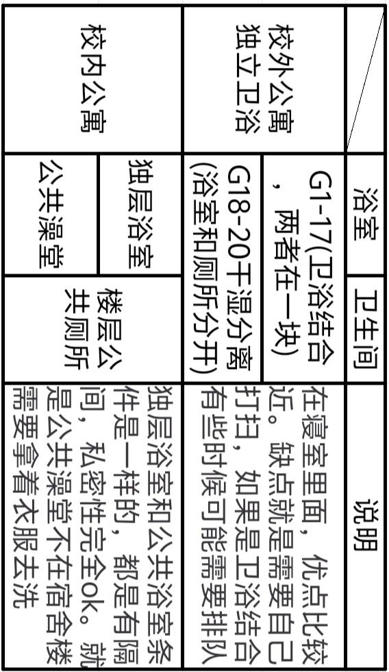
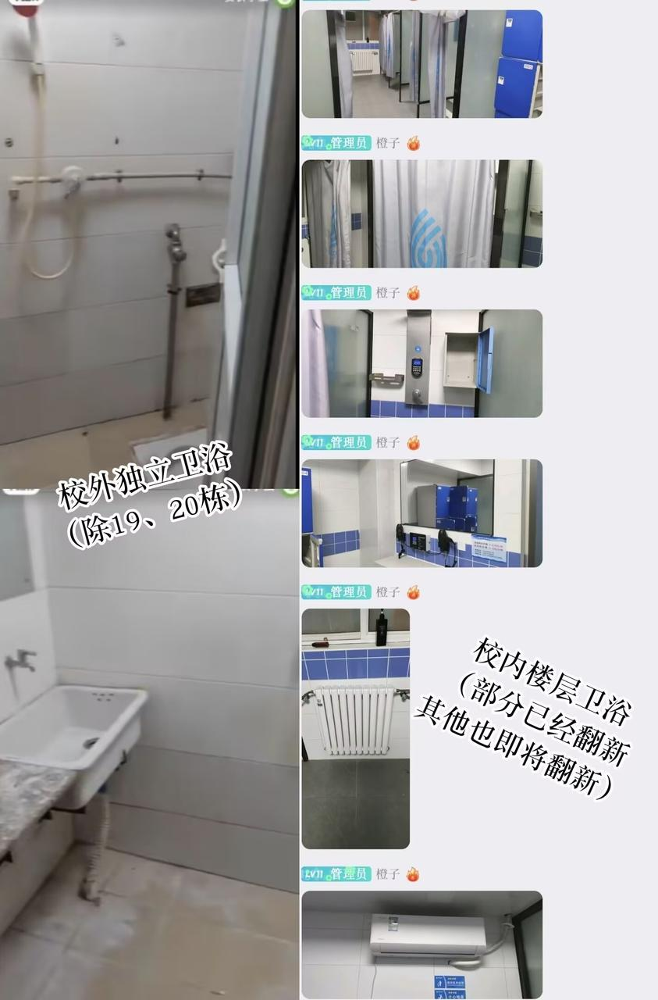
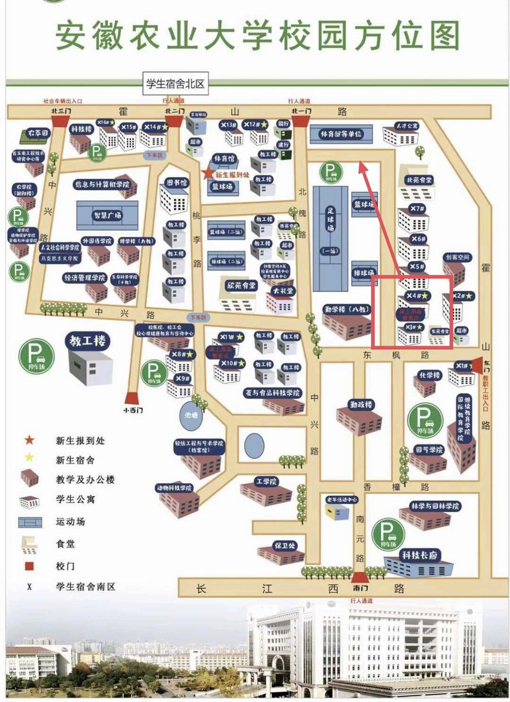

# 浴室及卫生间

> **所属模块**：生活专栏

### 浴室及卫生间

注:公共澡堂是X3-7(这几栋只有一层有栋浴，不够的话要去)，公共澡堂需要拿着衣服去“游泳馆体育部”。

::: tip 原始出处
本节整理自学习通专题「安农新生攻略」节点 [浴室及卫生间](https://mooc1.chaoxing.com/mooc-ans/ztnodedetailcontroller/visitnodedetail?courseId=253549820&knowledgeId=998070424)（Ⅰ.2.大学生活专栏）。
:::
