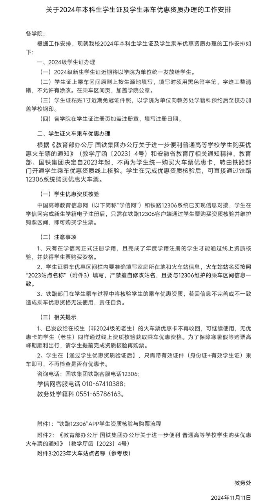

# 本科生学生证及学生乘车优惠资质办理

> **所属模块**：生活专栏

### 学生证及学生乘车优惠资质办理

## 相关文件

> 以下文件挂在学习通上，需登录后到专题页下载，后续会逐步镜像进本仓库。

- [附件1. “铁路12306”APP学生资质核验与购票流程.pdf](https://mooc1.chaoxing.com/mooc-ans/ztnodedetailcontroller/visitnodedetail?courseId=253549820&knowledgeId=998070425)（514.08 KB）
- [附件2. 教育部办公厅 国铁集团办公厅关于进一步便利普通高等学校学生购买优惠火车票的通知 .pdf](https://mooc1.chaoxing.com/mooc-ans/ztnodedetailcontroller/visitnodedetail?courseId=253549820&knowledgeId=998070425)（100.2 KB）
- [附件3. 2023年火车站点名称（参考版）.xls](https://mooc1.chaoxing.com/mooc-ans/ztnodedetailcontroller/visitnodedetail?courseId=253549820&knowledgeId=998070425)（281 KB）

::: tip 原始出处
本节整理自学习通专题「安农新生攻略」节点 [学生证及学生乘车优惠资质办理](https://mooc1.chaoxing.com/mooc-ans/ztnodedetailcontroller/visitnodedetail?courseId=253549820&knowledgeId=998070425)（Ⅰ.2.大学生活专栏）。
:::
