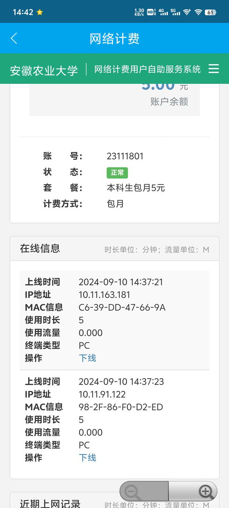

# 校园网

> **所属模块**：生活专栏

### 校园网

一.如何找回或重置密码

登录安徽农业大学官网点击智慧安农，或者直接进入智慧安农平台，点击“找回密码”，输入自己的学号/工号，输入验证码，默认选择手机号，点击“下一步”，点击“获取验证码”后，输入2遍新密码即可。

二.如何连接校园有线网

将电脑用网线连接至校园网端口上，右击Windows桌面右下角小电脑图标，依次点击“打开网络和共享中心”→“更改适配器设置”→对本地连接或以太网右键“属性”→

双击“Internet协议版本4”→选择“自动获取 IP 地址”，“自动获取 DNS 服务器”，点击“确定”。电脑插入网线后，打开你习惯用的浏览器，会出现以下页面，输入智慧安农账号密码登陆即可。

三.如何连接校园无线网

三个校园无线信号：ahau-portal、ahau、eduroam

(《上网账号密码》是《智慧安农账号密码》)

1.在校园ahau-portal无线信号覆盖区域内：使用手机、平板电脑、笔记本电脑搜索到ahau-portal信号，连接该信号，会自动弹出认证网页，使用智慧安农账号密码登陆即可。

2.在校园ahau无线信号覆盖区域内：

(如果ahau,密码正确输入但是显示密码错误，打开掌上安农-网络计费-在线信息全部下线)

（1）WIN10配置

正常连接无线 ahau，使用智慧安农账号密码登陆即可。

（2） 苹果IOS系统配置打开 wifi 网络，自动搜索信号,点击 ahau。出现认证页面，输入智慧安农用户名和密码，再点击接受证书即可。（3） Android 配置打开 wifi 网络，自动搜索信号,点击 ahau。设置验证方式如下所示，身份框中输入用户名，密码框中输入密码。

3.在校园eduroam无线信号覆盖区域内：它是专为科研和教育机构开发的安全的环球跨域无线漫游认证服务，现已覆盖全球七十余个国家和地区的超过6000家科研机构和教育机构，在全球 eduroam 覆盖区域，我校师生均可以搜索设置连接无线信号“eduroam”，免费使用该区域的无线网络。设置连接方法与我校 ahau 无线信号连接方法一致。此时用户名的格式为“学号/工号@ahau.edu.cn”，例如：20180000@ahau.edu.cn，密码与智慧安农一致。

::: tip 原始出处
本节整理自学习通专题「安农新生攻略」节点 [校园网](https://mooc1.chaoxing.com/mooc-ans/ztnodedetailcontroller/visitnodedetail?courseId=253549820&knowledgeId=998070427)（Ⅰ.2.大学生活专栏）。
:::
