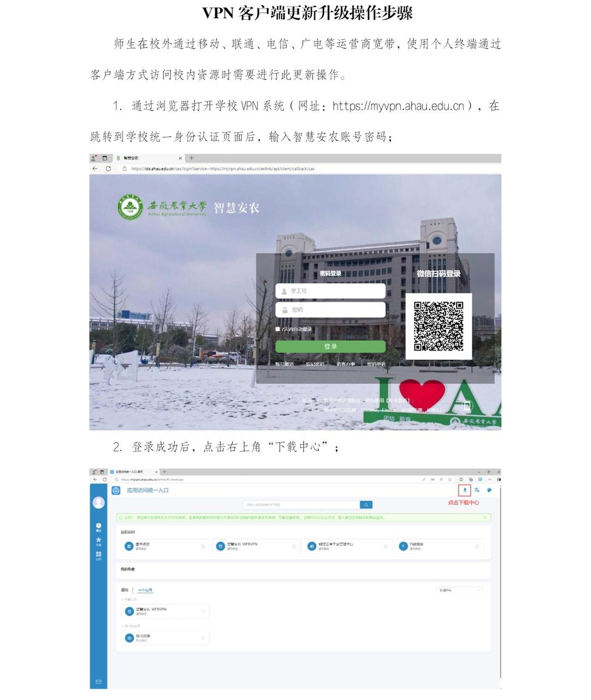
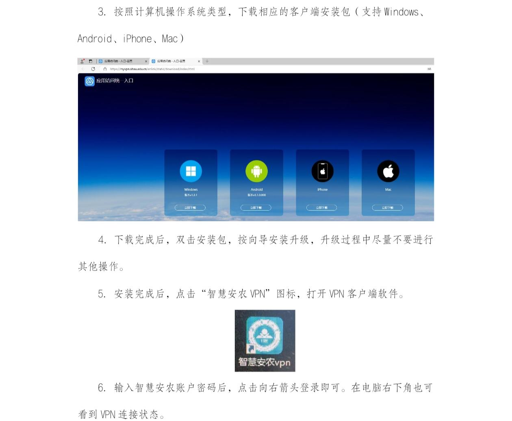
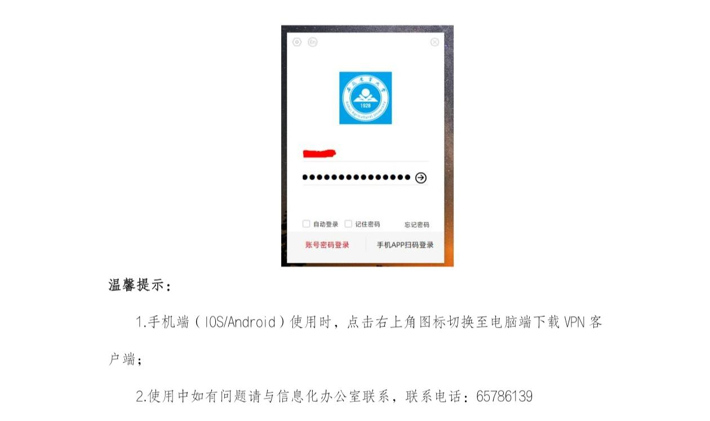

# 学校 VPN 说明

> **所属模块**：生活专栏

### 学校VPN说明

一.VPN（VirtualPrivateNetwork）：是虚拟专用网络的英文缩写，用来实现用户在单位网络外部安全访问单位内部网络资源的网络技术。为方便我校师生在校外使用学校内部网络资源，学校在2020年7月对VPN系统服务进行了升级，现将使用方法说明如下：

二.WebVPN：

1.电脑端用户在校外通过移动、联通、电信等运营商宽带使用电脑访问学校主页（www.ahau.edu.cn），点击右上角图示“智慧安农”图标，使用智慧安农账户密码登录成功后即可浏览学校通知公告、访问学校电子政务、教务系统等内网信息系统、下载CNKI等图书馆电子数据库资源。

2.手机端推荐关注“安徽农业大学”官方微信公众号，通过底部的智慧安农按钮，访问校内资源。

VPN客户端用户在校外通过移动、联通、电信等运营商宽带使用电脑访问学校VPN系统网址：https://myvpn.ahau.edu.cn

用户按照自己的操作系统类型下载相应的客户端安装包，然后按向导进行安装包组件安装升级，升级过程中尽量不要进行其他操作。

附:手机端安装包

安装完成后，点击智慧安农vpn客户端图标即可。在界面中输入智慧安农账户密码后，点击向右箭头登录后，VPN即可连接，在电脑右下角也可看到VPN连接状态。

三. 温馨提示：

1.手机端（IOS/Android）使用方法同电脑端；

2.使用过程中如有问题请与信息化办公室联系，联系电话：65786139。

访问学校教务系统、图书馆、通知公告等学校内部网络均需要连接VPN

微信和软件进入智慧安农会自动连上VPN

而在手机上用浏览器查看内部资源，要先打开软件，挂上VPN才可以继续浏览

如依旧不明白请联系3267509014

## 相关文件

> 以下文件挂在学习通上，需登录后到专题页下载，后续会逐步镜像进本仓库。

- [智慧安农VPN_EnAPP_android_v3.1.0.008.apk.1](https://mooc1.chaoxing.com/mooc-ans/ztnodedetailcontroller/visitnodedetail?courseId=253549820&knowledgeId=998070428)（35.71 MB）
- [未命名附件](https://mooc1.chaoxing.com/mooc-ans/ztnodedetailcontroller/visitnodedetail?courseId=253549820&knowledgeId=998070428)

::: tip 原始出处
本节整理自学习通专题「安农新生攻略」节点 [学校VPN说明](https://mooc1.chaoxing.com/mooc-ans/ztnodedetailcontroller/visitnodedetail?courseId=253549820&knowledgeId=998070428)（Ⅰ.2.大学生活专栏）。
:::
