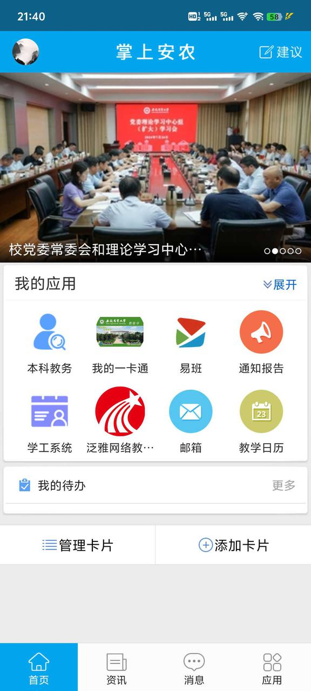
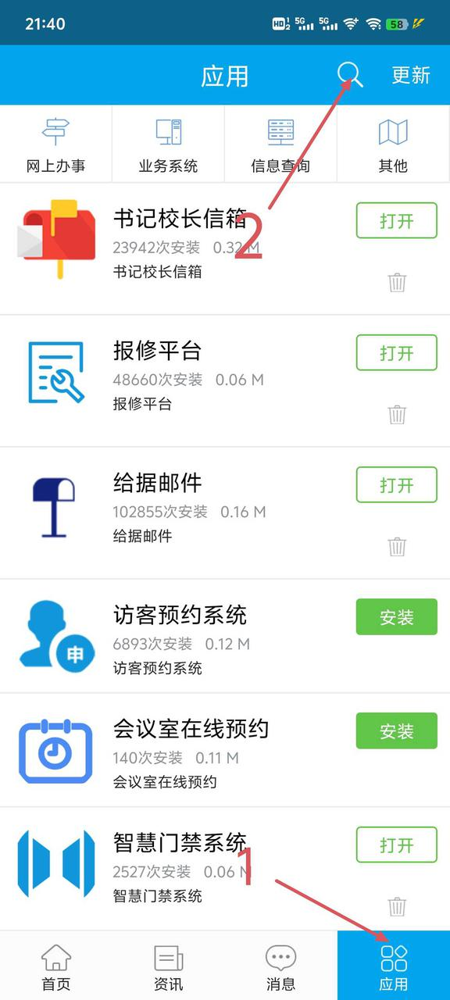
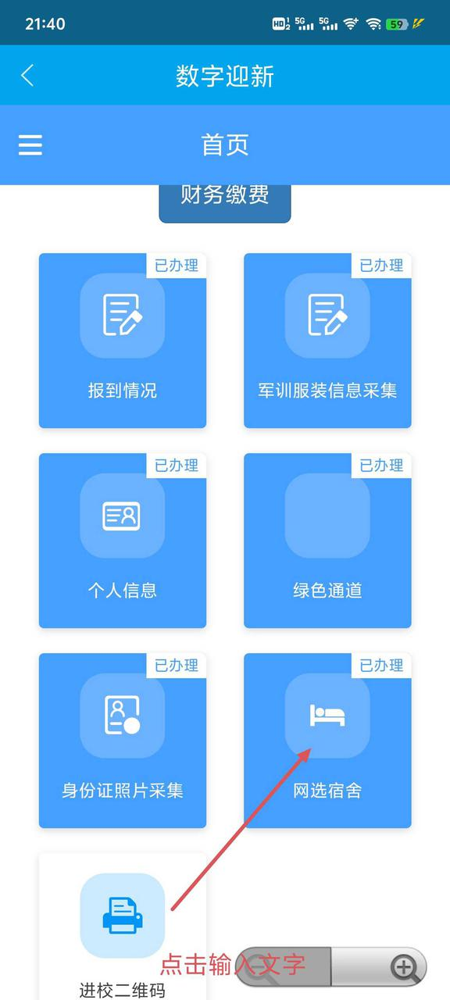

# 迎新系统使用及网选宿舍步骤

> **所属模块**：生活专栏

### 迎新系统使用及网选宿舍步骤

注意:1、2号床是靠阳台的，34(56)是靠门的。

无论宿舍南区还是宿舍北区，单号是向阳的，如227向阳，228背阳。

## 相关文件

> 以下文件挂在学习通上，需登录后到专题页下载，后续会逐步镜像进本仓库。

- [安徽农业大学迎新系统使用指南.pdf](https://mooc1.chaoxing.com/mooc-ans/ztnodedetailcontroller/visitnodedetail?courseId=253549820&knowledgeId=998070429)（2.46 MB）
- [未命名附件](https://mooc1.chaoxing.com/mooc-ans/ztnodedetailcontroller/visitnodedetail?courseId=253549820&knowledgeId=998070429)
- [未命名附件](https://mooc1.chaoxing.com/mooc-ans/ztnodedetailcontroller/visitnodedetail?courseId=253549820&knowledgeId=998070429)

::: tip 原始出处
本节整理自学习通专题「安农新生攻略」节点 [迎新系统使用及网选宿舍步骤](https://mooc1.chaoxing.com/mooc-ans/ztnodedetailcontroller/visitnodedetail?courseId=253549820&knowledgeId=998070429)（Ⅰ.2.大学生活专栏）。
:::
