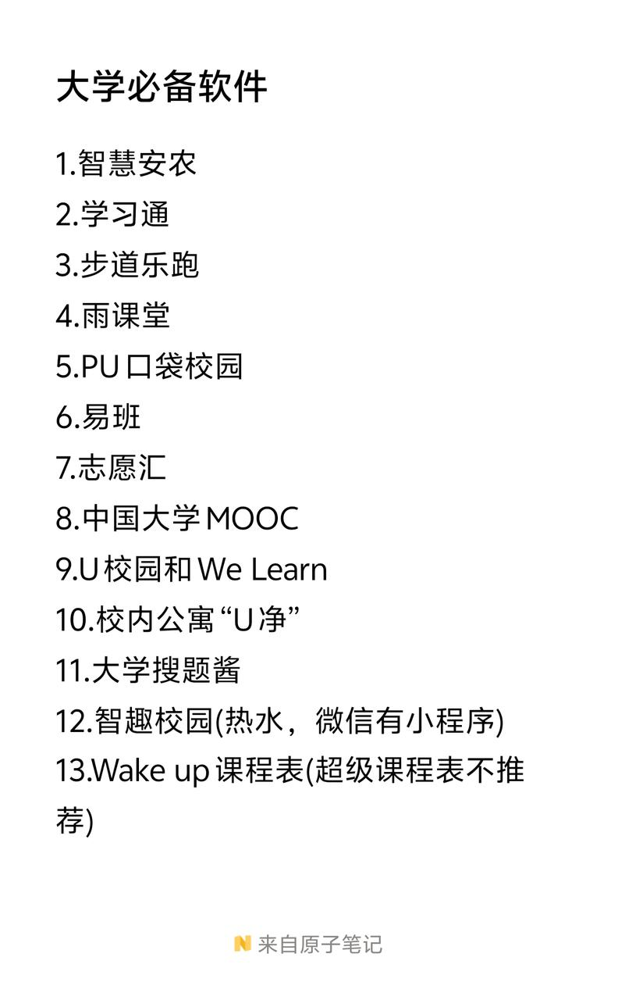

# 大学必备软件

> **所属模块**：生活专栏

### 大学必备软件

补充Wake up课程表课程导入

## 相关文件

> 以下文件挂在学习通上，需登录后到专题页下载，后续会逐步镜像进本仓库。

- [智慧安农.apk](https://mooc1.chaoxing.com/mooc-ans/ztnodedetailcontroller/visitnodedetail?courseId=253549820&knowledgeId=998070430)（20.48 MB）
- [附件1：安徽农业大学2023级新生学生手册考试易班操作说明.pdf](https://mooc1.chaoxing.com/mooc-ans/ztnodedetailcontroller/visitnodedetail?courseId=253549820&knowledgeId=998070430)（1.34 MB）
- [附件2：安徽农业大学2023级《学生手册》考试题库.pdf](https://mooc1.chaoxing.com/mooc-ans/ztnodedetailcontroller/visitnodedetail?courseId=253549820&knowledgeId=998070430)（601.71 KB）
- [学习通操作说明.pptx](https://mooc1.chaoxing.com/mooc-ans/ztnodedetailcontroller/visitnodedetail?courseId=253549820&knowledgeId=998070430)（19.75 MB）
- [PU及二课素拓.pptx](https://mooc1.chaoxing.com/mooc-ans/ztnodedetailcontroller/visitnodedetail?courseId=253549820&knowledgeId=998070430)（3.86 MB）
- [办公室软件.pptx](https://mooc1.chaoxing.com/mooc-ans/ztnodedetailcontroller/visitnodedetail?courseId=253549820&knowledgeId=998070430)（1.98 MB）
- [志愿汇操作说明.pptx](https://mooc1.chaoxing.com/mooc-ans/ztnodedetailcontroller/visitnodedetail?courseId=253549820&knowledgeId=998070430)（1.47 MB）
- [学习通、易班、志愿汇及办公软件.zip](https://mooc1.chaoxing.com/mooc-ans/ztnodedetailcontroller/visitnodedetail?courseId=253549820&knowledgeId=998070430)（28.01 MB）
- [未命名附件](https://mooc1.chaoxing.com/mooc-ans/ztnodedetailcontroller/visitnodedetail?courseId=253549820&knowledgeId=998070430)

::: tip 原始出处
本节整理自学习通专题「安农新生攻略」节点 [大学必备软件](https://mooc1.chaoxing.com/mooc-ans/ztnodedetailcontroller/visitnodedetail?courseId=253549820&knowledgeId=998070430)（Ⅰ.2.大学生活专栏）。
:::
