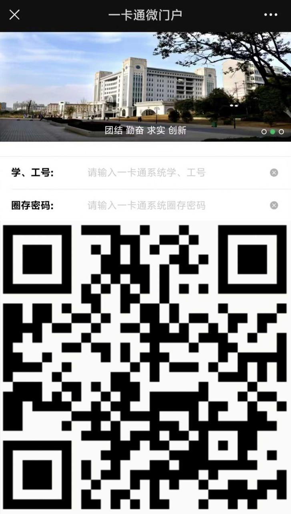

# 校园一卡通

> **所属模块**：生活专栏

### 校园一卡通

校园一卡通微门户

(初始密码为身份证号后六位，遇X用0代替)

①微信/支付宝/银联云闪付  扫码可直接缴费

②快捷链接直达智慧安农

1.校园一卡通网络平台操作指南

2.校园一卡通多媒体机器

3.学生缴费操作指南

4.校园卡签约绑定银行卡

①建行卡绑定校园一卡通

②徽商卡绑定校园一卡通

5.校园一卡通常见问题

## 相关文件

> 以下文件挂在学习通上，需登录后到专题页下载，后续会逐步镜像进本仓库。

- [未命名附件](https://mooc1.chaoxing.com/mooc-ans/ztnodedetailcontroller/visitnodedetail?courseId=253549820&knowledgeId=998070431)
- [未命名附件](https://mooc1.chaoxing.com/mooc-ans/ztnodedetailcontroller/visitnodedetail?courseId=253549820&knowledgeId=998070431)
- [未命名附件](https://mooc1.chaoxing.com/mooc-ans/ztnodedetailcontroller/visitnodedetail?courseId=253549820&knowledgeId=998070431)
- [未命名附件](https://mooc1.chaoxing.com/mooc-ans/ztnodedetailcontroller/visitnodedetail?courseId=253549820&knowledgeId=998070431)
- [未命名附件](https://mooc1.chaoxing.com/mooc-ans/ztnodedetailcontroller/visitnodedetail?courseId=253549820&knowledgeId=998070431)
- [未命名附件](https://mooc1.chaoxing.com/mooc-ans/ztnodedetailcontroller/visitnodedetail?courseId=253549820&knowledgeId=998070431)
- [未命名附件](https://mooc1.chaoxing.com/mooc-ans/ztnodedetailcontroller/visitnodedetail?courseId=253549820&knowledgeId=998070431)

::: tip 原始出处
本节整理自学习通专题「安农新生攻略」节点 [校园一卡通](https://mooc1.chaoxing.com/mooc-ans/ztnodedetailcontroller/visitnodedetail?courseId=253549820&knowledgeId=998070431)（Ⅰ.2.大学生活专栏）。
:::
