# 校园分布

> **所属模块**：生活专栏

### 校园分布

⭐我校位于合肥市一环内的市中心城区，北接霍山路，南临长江西路。分为学生社区南区和学生社区北区，由天桥连接。众多教学楼、办公楼都分布在校内。

地图平面图

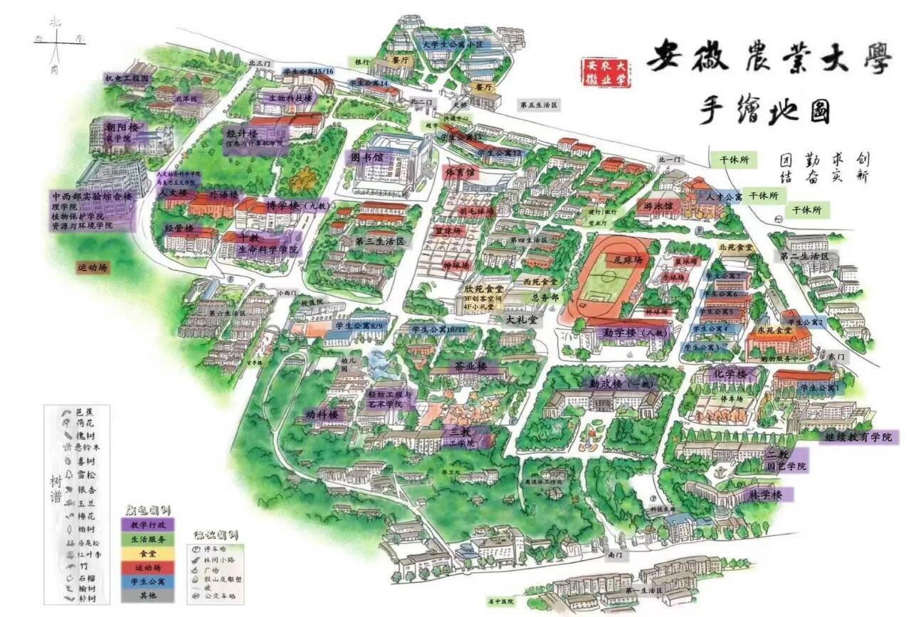

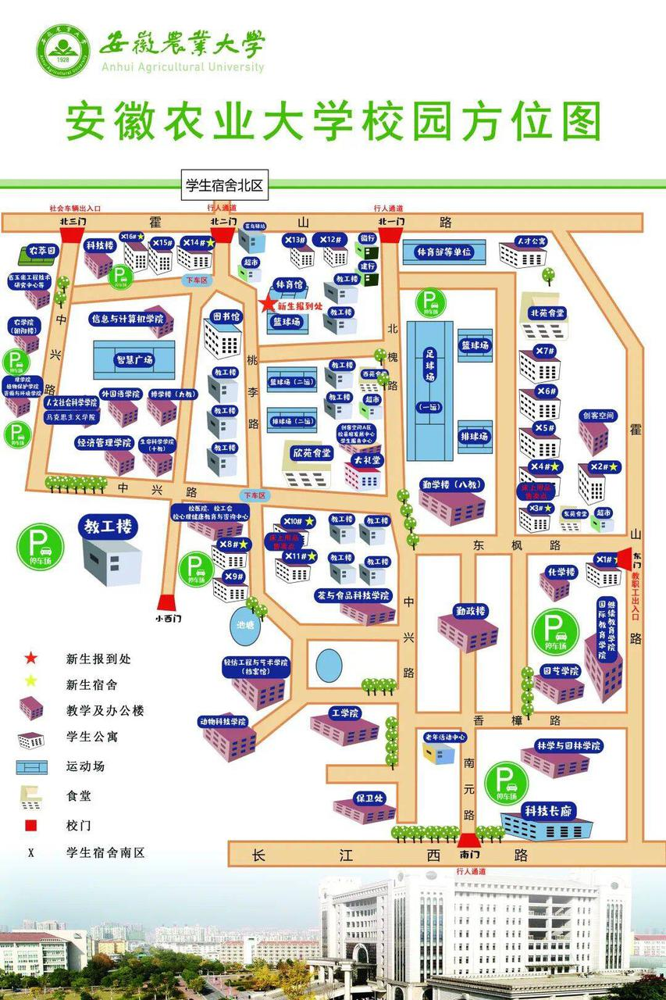

⭐教学楼

八教勤学楼，九教博学楼，以及各个学院楼。

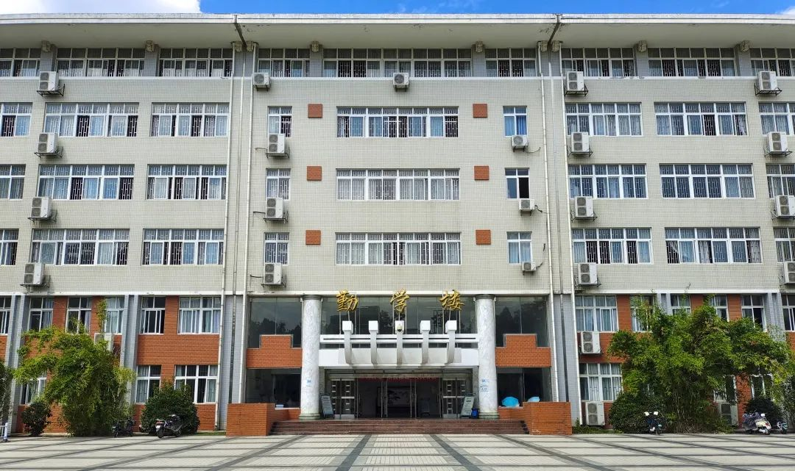

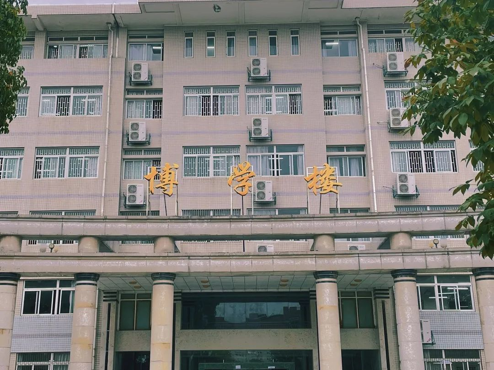

⭐办公楼(勤政楼)

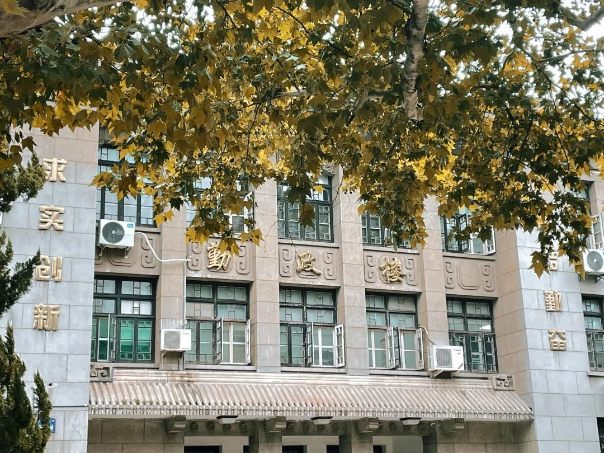

⭐食堂

一.校内：

东苑食堂

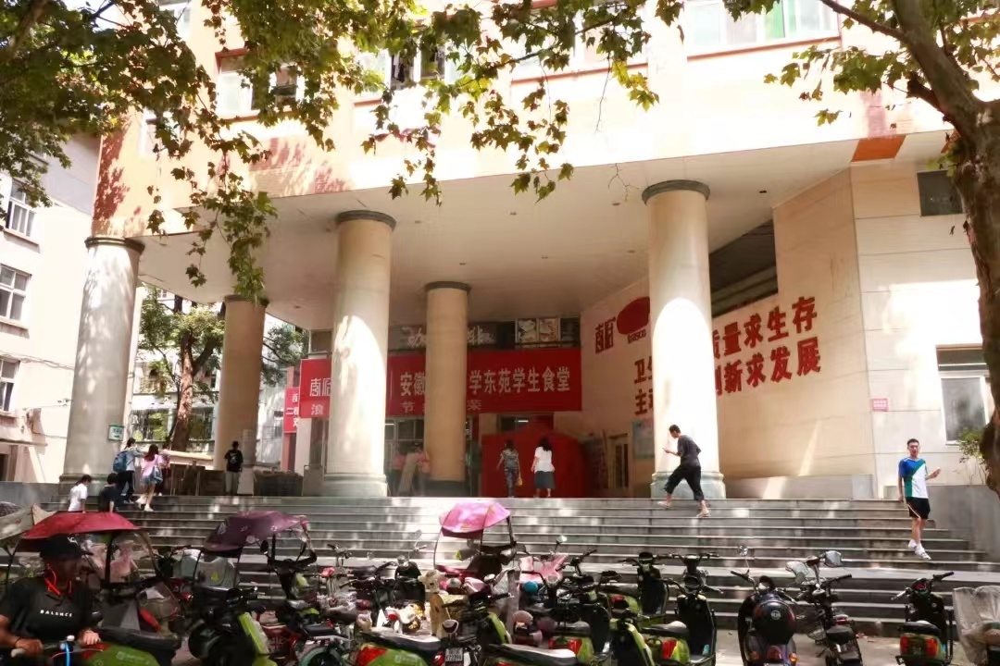

西苑食堂

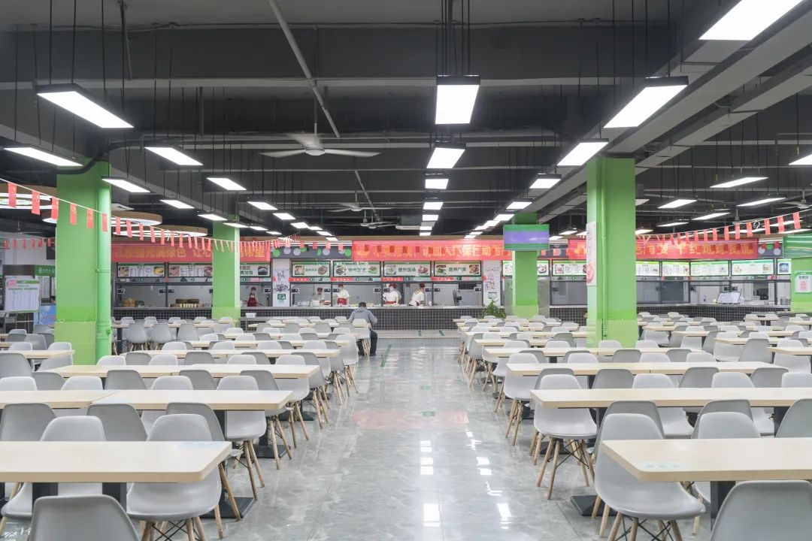

北苑食堂

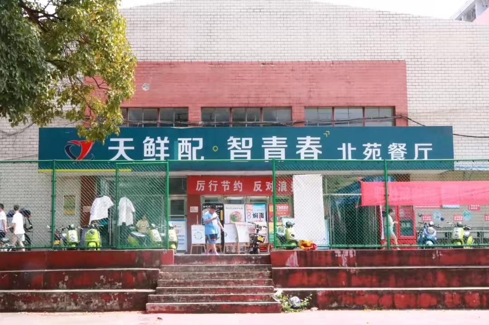

欣苑食堂

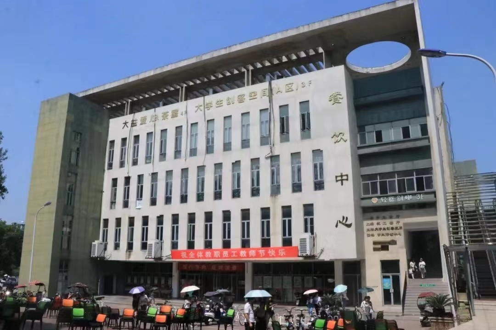

二.校外：

思源食堂

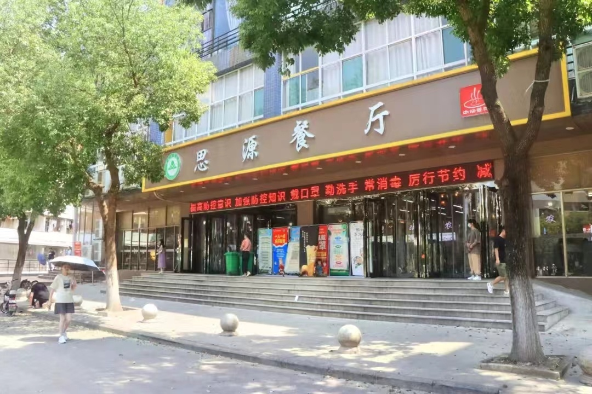

丰泽食堂

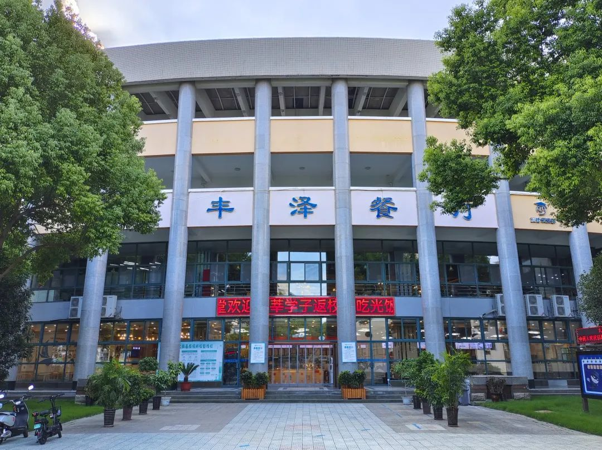

⭐图书馆

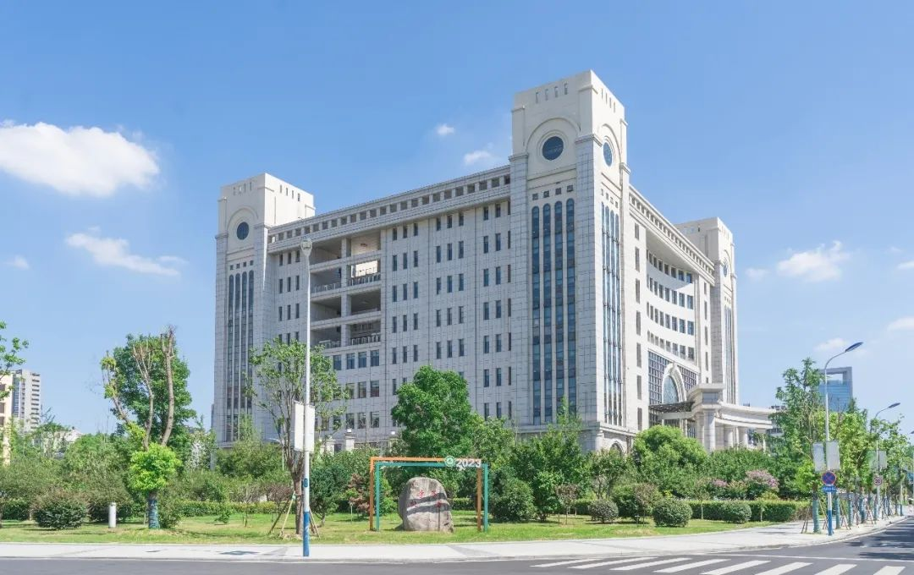

⭐运动场所

①第一运动场（操场，靠近北一门有乒乓球室，游泳馆，练舞房，健身房）

②第二运动场（篮球场羽毛球场旁边有体育馆）

③第三运动场（校外，羽毛球馆乒乓球馆）

④第四运动场（很少开放）

⭐ 超市

- 东门红府超市

- 西苑旁安农后勤超市

- 北二门红府

⭐其他场所

- 打印店

(西苑旁边有三个打印店1毛1张，北二门外的中国移动)

- 眼镜店

- 裁缝店

- 运动器械店

- 养老院

- 幼儿园

- 校医院

- 智慧广场

::: tip 原始出处
本节整理自学习通专题「安农新生攻略」节点 [校园分布](https://mooc1.chaoxing.com/mooc-ans/ztnodedetailcontroller/visitnodedetail?courseId=253549820&knowledgeId=998070432)（Ⅰ.2.大学生活专栏）。
:::
