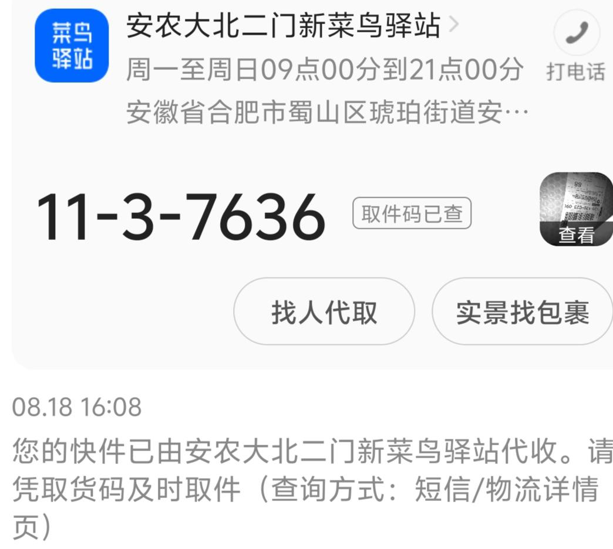
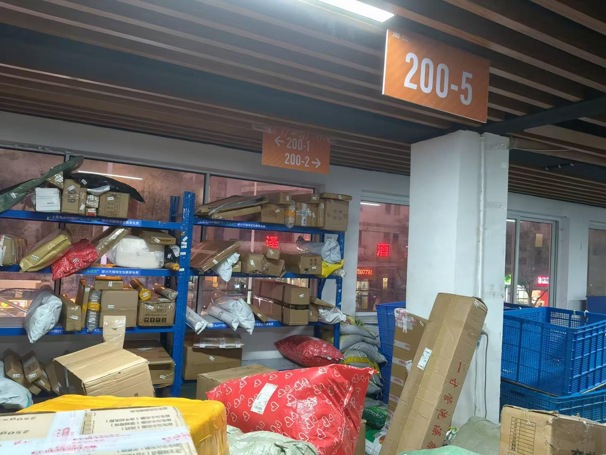
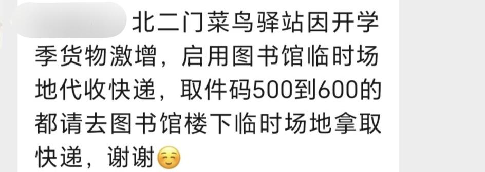
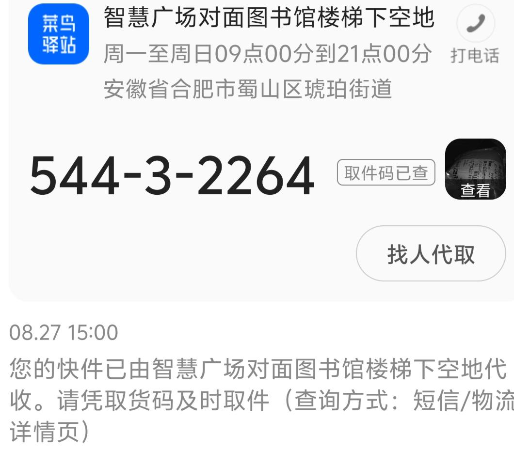
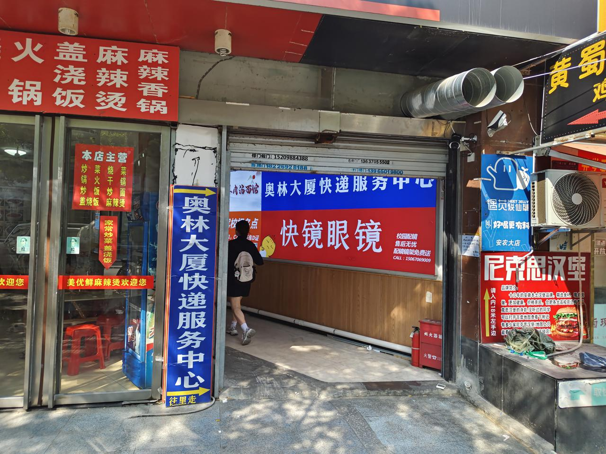
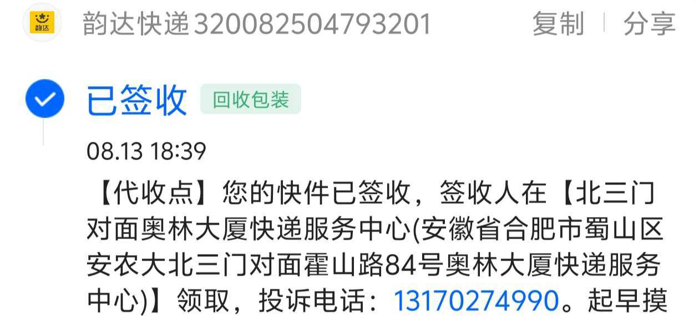
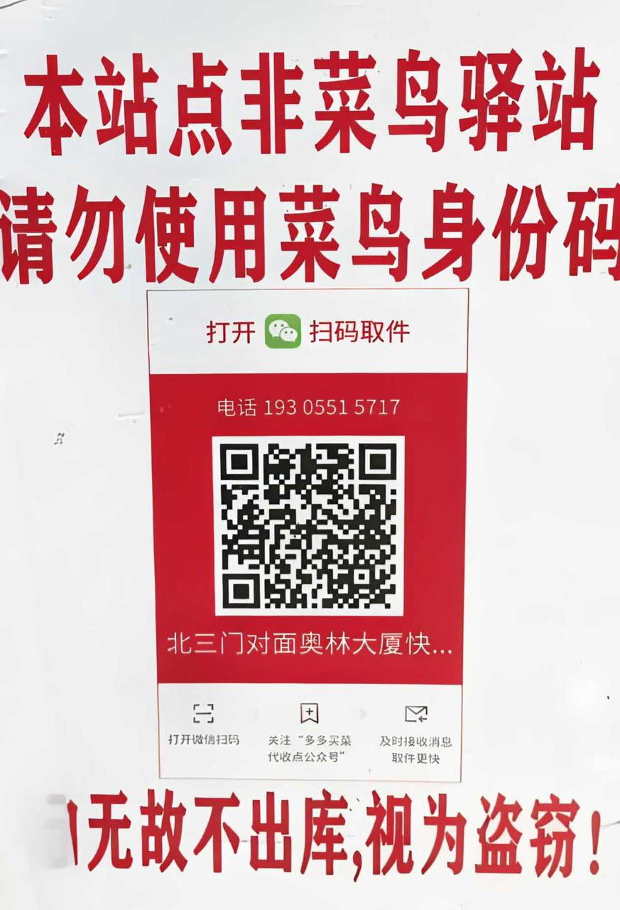

# 快递篇

> **所属模块**：生活专栏

### 快递篇

1.邮寄地址:安徽省合肥市蜀山区琥珀街道长江西路130号长江安徽农业大学北二门菜鸟驿站

2.邮件接收地址(派件的话一般是以下三个地方)

①平时的快递主要在《北二门快递服务中心》，那里<二楼>有菜鸟驿站(接收邮政，圆通，中通，申通，特征是取件码开头的货架号1-200，200在最里面见下图)

和<一楼>顺丰(取件码800以上)、京东网点

如图:

(200号取件号所在地方)
②开学季北二门货物激增，启用临时场地一一《智慧广场对面图书馆楼梯下空地》(即图书馆-1层)代收快递，特征是取件码开头的货架号是500一600。

如图:

③然后你在拼多多上买的有大部分快递(比如极兔、韵达快递)会送到《北三门奥林大厦快递服务中心》

如图:

3.如何取件

(1)取件地址:在网购平台或者菜鸟APP都可以查到取件地址。

(2)取件码

如果快递到了菜鸟驿站，淘宝购买的会自动同步出现取件码，如果是在其他平台(如拼多多)购买的，需要复制快递单号，在“淘宝-我的驿站-服务台-粘贴快递单号查询取件码”。(参见<2-①、②﹥淘宝身份码)

而如果是到了北三门驿站，则需要用公众号查询取件码。(参见2-<③﹥在微信关注公众号)

我们可以根据驿站指示牌以及工作人员提示找到快递。

附:(驿站机器扫描自动出库，需要身份码出库)

<2-①、②﹥淘宝身份码(不是菜鸟app身份码)

2-<③﹥在微信关注这个公众号，并找到身份码服务，绑定手机号就可以查到

::: tip 原始出处
本节整理自学习通专题「安农新生攻略」节点 [快递篇](https://mooc1.chaoxing.com/mooc-ans/ztnodedetailcontroller/visitnodedetail?courseId=253549820&knowledgeId=998070435)（Ⅰ.2.大学生活专栏）。
:::
