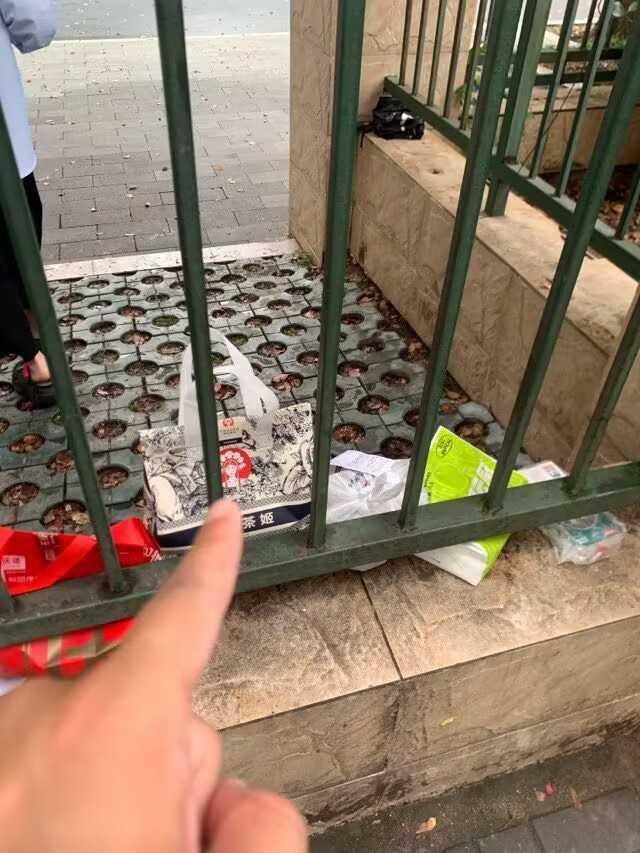
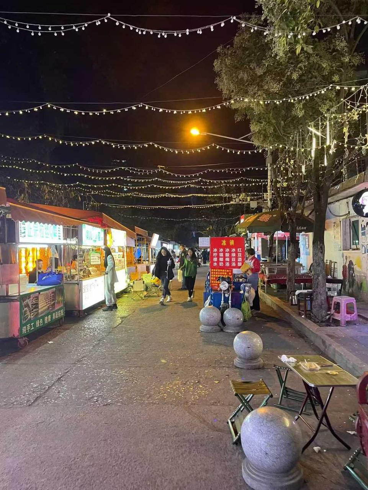
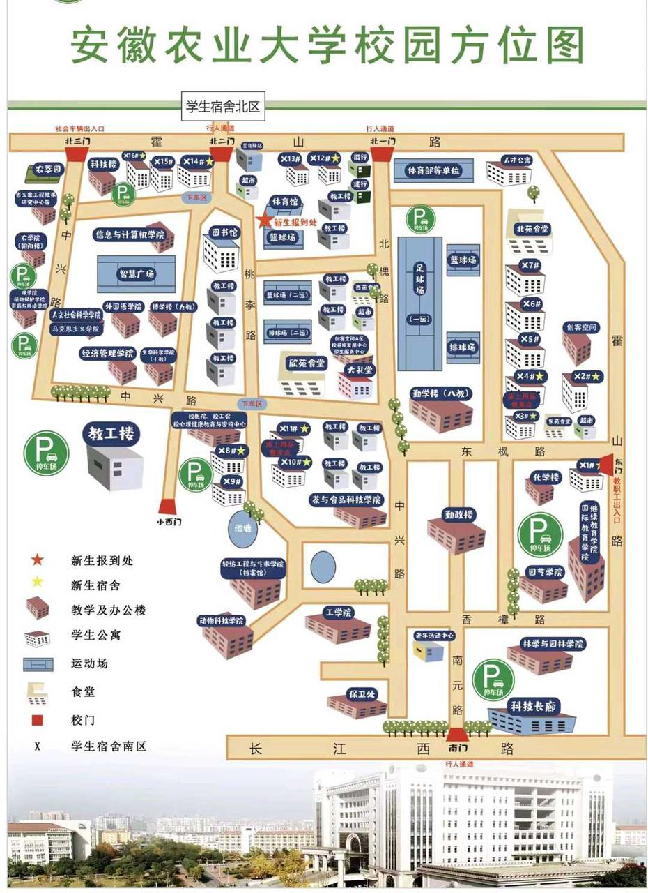

# 外卖及小吃街

> **所属模块**：生活专栏

### 外卖及小吃街

⭐一.外卖

- 价格相较食堂可能会贵一些，卫生不好说

- 南北方饮食习惯差异较大，外省来上大学的宝子们如果不习惯，可以偶尔点外卖调节一下口味

⭐(一)校内：

- 通过美团，饿了么等外卖软件不能直接送到寝室，学校安保还是做的很不错滴

- 外卖地址填写宿舍楼就近的学校大门（安徽农业大学东门/北一门/北二门/北三门/南门)

- 比如，住在校内一栋（东门区域的宿舍楼），外卖地址可以直接填写“安徽农业大学东门”

⭐(二)校外公寓：

- 这里要着重说一下校外公寓

- 住在校外公寓的同学可以直接填写“安徽农业大学校外公寓”

- 这个时候你可能会收到外卖小哥的电话或消息“给你放到小吃街栅栏了”，这里的“小吃街栅栏”其实就是校外公寓大门两边的学校围栏

- 宝子们一定要分清楚是东边栅栏还是西边栅栏哦（一般外卖小哥都会默认放到西边栅栏的~）

⭐二.小吃街：(学校外有三条小吃街)

①一条在校外公寓，一般称为“北二门小吃街”

②一条在东门

②还有一条与小西门相通，一般称为“官亭路小吃街”

附一张安农大地图

::: tip 原始出处
本节整理自学习通专题「安农新生攻略」节点 [外卖及小吃街](https://mooc1.chaoxing.com/mooc-ans/ztnodedetailcontroller/visitnodedetail?courseId=253549820&knowledgeId=998070436)（Ⅰ.2.大学生活专栏）。
:::
