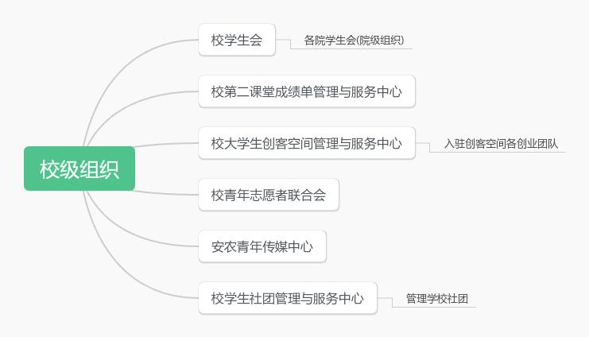
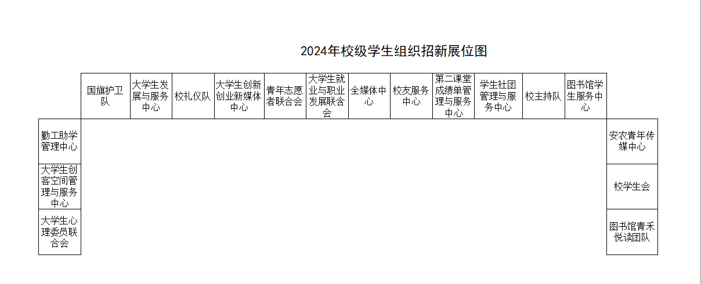
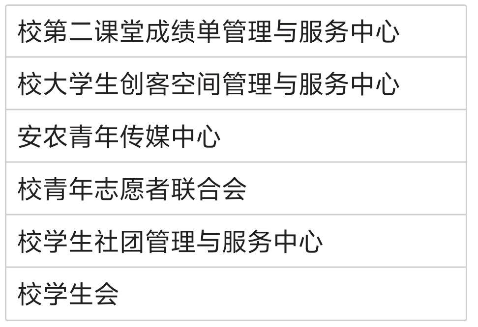
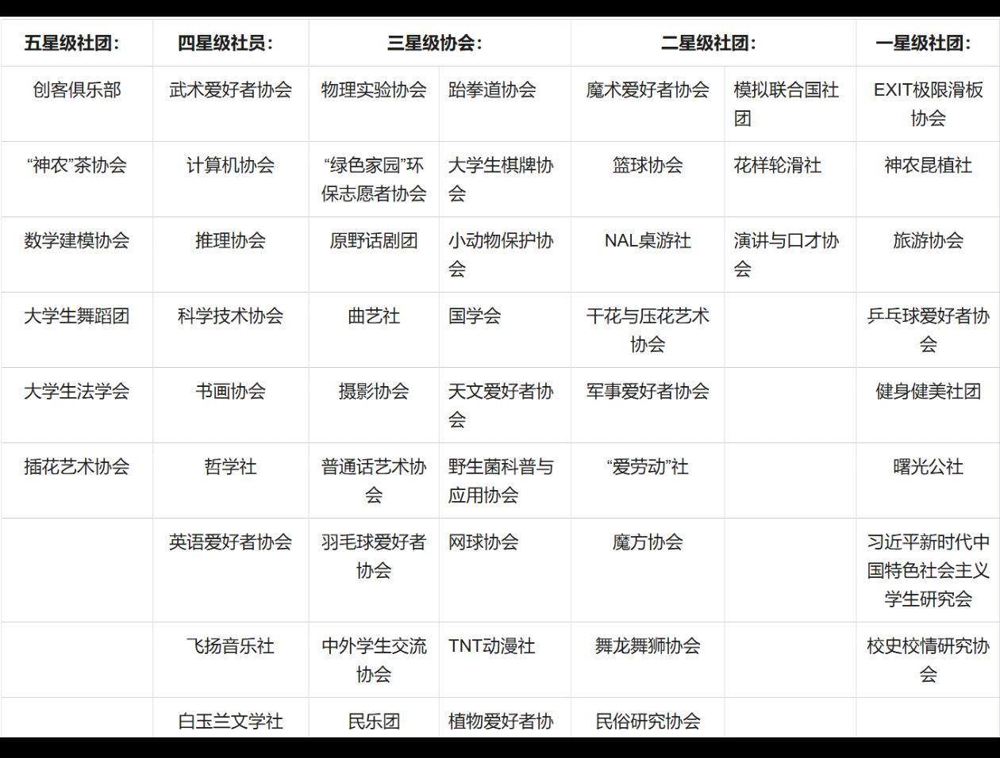

# 部门社团

> **所属模块**：生活专栏

### 部门社团

Ⅰ安徽农业大学学生组织(部门)

1.校级组织

Ⅱ安徽农业大学社团

⭐一. 部门社团

1.加入渠道：开学各个社团会通过线上、线下的渠道（百团大战）进行纳新活动，大家可及时关注。

2.如何加入：部分社团由于加入人数过多，需要面试后才能加入，有些人填写申请表后可以直接加入。

⭐二.进入大学要不要加社团？不加社团就可以自由安排时间？

⭐(一)多数大学生现状（希望没你）：

- 我经过各方了解后，发现多数大学生现状：--逃课宿舍睡懒觉睡得天荒地老。

- 打游戏打得昏天黑地。

- 追剧追到无剧可追。

- 逛淘宝逛到生活吃土。

- 刷抖音到半夜精神抖擞。 第二天上课打瞌睡。

- 期末疯狂找小伙伴带你60分万岁。

- 你想过这种生活吗?

⭐(二) 如何判定自己该不该加入社团和学生会呢？

- 首先，你得给自己几秒钟，摸着胸脯肉问问自己：我加入学生会社团图个啥？

- 为了减少二氧化碳排放，阻止全球变暖？

- 为了买彩票中奖成为亿万富翁？

- 还是为了帮助人类繁衍？

- 不过这些统统与你无关。

- “图个啥”准确地来说是：在这个过程中，我能否得到自我提升？

- 我国著名企业家、青年教育家李开复曾说过这么一句话，让我后悔为什么没早点知道：

大学是人生的关键阶段。可能是你最后一次将大段时间用于学习的人生阶段，也可能是最后一次可以拥有较高的可塑性、集中精力充实自我的成长历程。这也许是你最后一次能在相对宽容的，可以置身其中学习为人处世之道的理想环境。所以，在你这个不到二十岁的年纪，任何不以自我提升为目的的行为都是在耍流氓。

⭐(三) 社团的好处：

- 为自己加分：如果你在社团担任过部长或者会长等职位，这绝对是你以后工作应聘时的加分项。企业需要这种有一定管理能力的人。所以在大学期间就应该多多锻炼自己这一方面的能力。

- 找到知己：基本上加入同一个社团的人都有共同的爱好，在这当中你很可能找到自己的知己。你们可以交流共同喜欢的东西，这是一件幸福的事。谈恋爱啊，多好的机会呐，不要错过。

- 让自己更加自信。（大学是学生到社会的过度阶段）：加入社团意味着你要学会社交，学会处理人际关系，这时候就是强迫你变得更好的时候。当你变得越来越好的时候，自信心自然会增长。

- 充实生活：加入社团可以让生活变得更充实。大学生活通常都比较闲暇，如果你不找些事来做的话可能整个大学都是在床上躺过去的。所以提醒一些刚进大学的同学，一定不要浪费时间。

- 交际：我们在加入一个社团以后不仅会和同一个社团的朋友交际，还可能会和其他的社团的有联合活动。所以在大学期间加入社团可以扩大自己的交际圈子。

- 学习知识：社团就是一个培养自己兴趣爱好的地方，你能够学到你所去的社团相对应的知识。这些知识可能不像你的专业知识一样体现得那么直接，但慢慢的你就会发现，它绝对可以增添你的个人魅力。

- 提高管理能力。（本条是对第一条的补充）每个社团都会有很多的部门。我们可以根据自己的爱好和能力选择不同的部门。在社团里当上部长或者是会长都有利于我们提高自己的管理能力。这种管理能力在以后的工作上一定会发挥一定的作用。

⭐(四)过度的参加社团的劣处：

弊端就是如果加入社团太多，你自己的时间就会越来越少，因为每个社团都有自己的社团活动时间，(●°u°●) 」你确定你善于管理时间？

- 专业课学习可能会落下：每天处在一个很忙碌的状态里，时间短的话还好，时间长了就会烦躁、乏味，严重的久而久之失去兴趣，这是所有人都不愿意看到的。

- 第一条的情况还不够吗：如果挂科严重，你等着吧，补考重修只是小问题，辅导员时不时找你谈话甚至降级都是有可能的。

⭐(五)对你加入社团的建议：

- 你会什么技能？如果没有，请问你怎么去学习？（请写出详细方法）这道题当然有标准答案，

- 如果你有一些技能，我需要看你的技能是否对个人成长有没有帮助，对我的这个社团有没有帮助。

- 如果你说你没有，重点来了，我需要看你的学习途径，如果你的途径操作可行，我会录用你。（我希望看到你的自我学习的热情）

- 当然我不管你们在你们以后的社团招新中怎么回答面试问题，但我希望你们保持一颗热爱学习的心。 这才是我们的初心吧。

## 相关文件

> 以下文件挂在学习通上，需登录后到专题页下载，后续会逐步镜像进本仓库。

- [社团名单.xlsx](https://mooc1.chaoxing.com/mooc-ans/ztnodedetailcontroller/visitnodedetail?courseId=253549820&knowledgeId=998070437)（13.21 KB）

::: tip 原始出处
本节整理自学习通专题「安农新生攻略」节点 [部门社团](https://mooc1.chaoxing.com/mooc-ans/ztnodedetailcontroller/visitnodedetail?courseId=253549820&knowledgeId=998070437)（Ⅰ.2.大学生活专栏）。
:::
